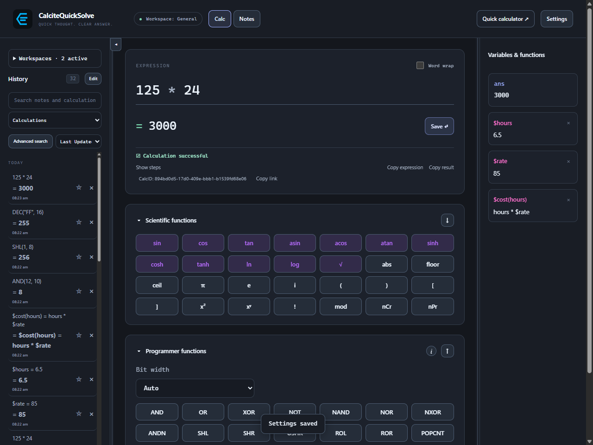
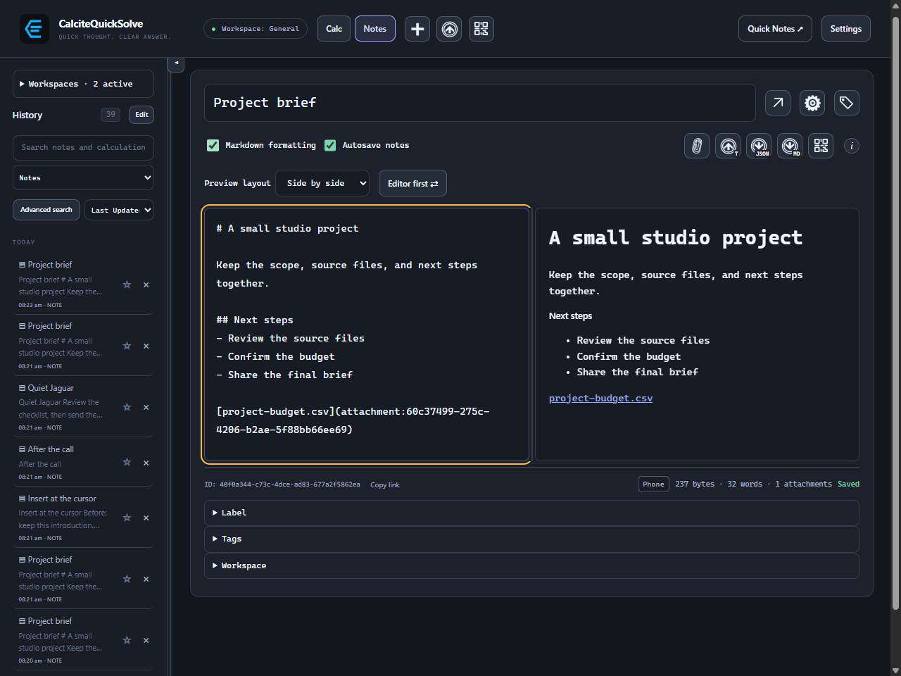
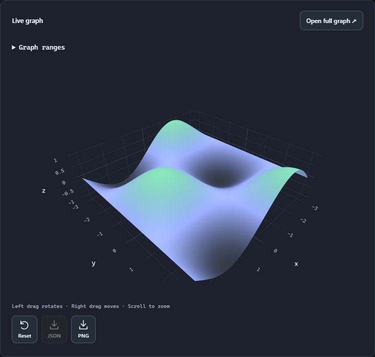

# CalciteQuickSolve

A scientific and programmer calculator with 2D/3D graphs, reusable variables and
functions, and Markdown notes with attachments, encryption and synced history.

Visit **[calcitequicksolve.app](https://calcitequicksolve.app/)** for features,
demos and guides. This repository is the public home for downloads, issue reports
and release-specific technical details.

  
  
  

## Latest release

**[1.0.0](https://github.com/calcitequicksolve/CalciteQuickSolve/releases/tag/v1.0.0)**
is the production release, including note history, automatic merging and conflict review.
Previous versions have been withdrawn from public download.

| Platform | Download |
| --- | --- |
| Windows x64 | [Installer](https://github.com/calcitequicksolve/CalciteQuickSolve/releases/download/v1.0.0/CalciteQuickSolve_1.0.0_x64-setup.exe) · [Standalone EXE](https://github.com/calcitequicksolve/CalciteQuickSolve/releases/download/v1.0.0/CalciteQuickSolve-1.0.0.exe) |
| Android 11+, ARM64 | [Signed APK](https://github.com/calcitequicksolve/CalciteQuickSolve/releases/download/v1.0.0/CalciteQuickSolve-1.0.0-android-arm64.apk) |

[Release notes](release-notes/1.0.0.md) ·
[SHA-256 checksums](https://github.com/calcitequicksolve/CalciteQuickSolve/releases/download/v1.0.0/SHA256SUMS.txt) ·
[All releases](https://github.com/calcitequicksolve/CalciteQuickSolve/releases)

## Beta

Version 1.0.1 adds the self-hosted server, browser UI, and encrypted server
connections for Windows and Android.
[1.0.1 Beta downloads](https://github.com/calcitequicksolve/CalciteQuickSolve/releases/tag/v1.0.1) ·
[Docker and Compose quickstart](docs/hosted-server/README.md)

## Documentation

The website has the main product guides. Copies are available here and offline
in the app's Settings → Help & Docs:

- [Getting started](docs/getting-started.md) and [calculations](docs/calculations.md)
- [Notes](docs/notes.md) and [attachments](docs/note-files.md)
- [Workspaces and synchronization](docs/sync.md), including the [Syncthing example](docs/syncthing.md)
- [Keys and encryption](docs/keys-and-encryption.md) and [backups](docs/security-and-backups.md)
- [1.0.0 release verification](docs/verification-1.0.0.md) and the [pre-release synchronization audit](docs/verification-0.1.8.md), with tested scenarios and practical limits

## Issues and suggestions

[Report a bug](https://github.com/calcitequicksolve/CalciteQuickSolve/issues/new?template=bug_report.yml)
or [suggest a feature](https://github.com/calcitequicksolve/CalciteQuickSolve/issues/new?template=feature_request.yml).
Search [existing issues](https://github.com/calcitequicksolve/CalciteQuickSolve/issues)
for related reports first.

For bugs, include the app version, platform, operating-system version, steps to
reproduce, expected and actual results, and screenshots or a recording when useful.
For sync problems, describe the devices and sync apps involved, what each device
changed, and whether any app was closed, locked or offline. The issue forms prompt
for these details.
