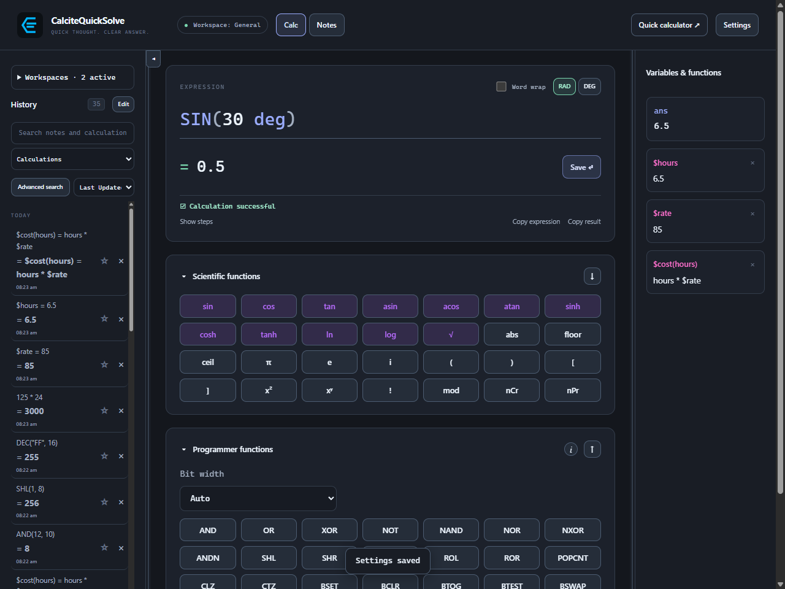
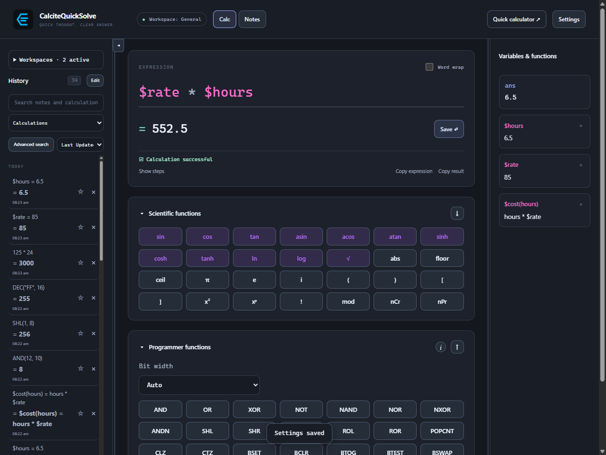
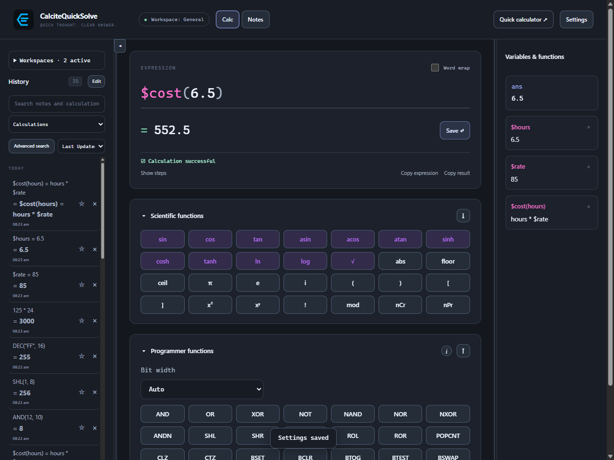
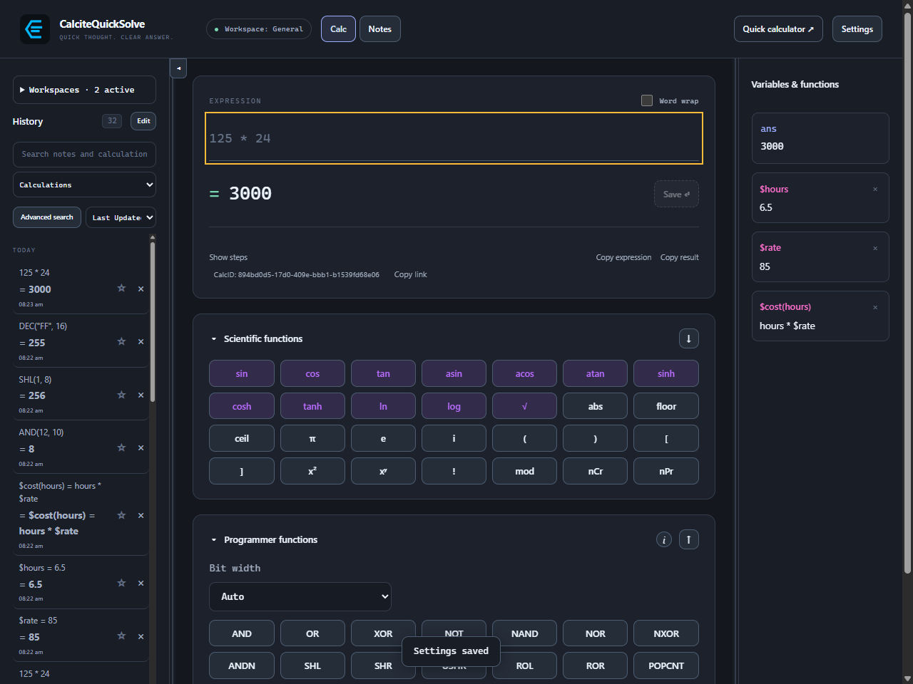

# Expressions that build on each other.

Use live results, saved variables, and your own functions to keep repetitive work small.

<a id="expressions"></a>

## Write an expression

Enter a numerical expression in the calculator. Results appear as you type; Enter saves the calculation to History and clears the input. Use Ctrl + L to clear the current expression without saving. Parentheses make the intended order explicit.

```
125 * 24
(125 + 75) / 4
sqrt(144)
```

<a id="scientific"></a>

## Use scientific functions

Open Scientific functions beneath the expression field to insert a built-in function or type the call directly. Built-in scientific and programmer calls are case-insensitive and do not use a $ prefix.

```
sin(30 deg)
SIN(30 deg)
sqrt(144)
ln(e)
log(100)
```

> These expressions return 0.5, 0.5, 12, 1, and 2. Use the RAD/DEG controls for angle-dependent functions; an explicit angle unit overrides the selected mode.



<a id="variables"></a>

## Save a variable

Prefix a variable name with $. Save each definition separately, or separate statements with semicolons to define and use names in one calculation. Update a saved definition when the underlying value changes.

- Variable names start with $ followed by a letter or underscore, then letters, digits, or underscores.
- Click a saved name in the sidebar to insert it, or its value to edit the definition.
- Built-in constants such as pi and ans, and graph coordinates x and y, stay bare.

```
$rate = 85
$hours = 6.5
$rate * $hours
```

> The final expression evaluates to 552.5. This example is a simple project estimate, not a currency-conversion feature.



<a id="functions"></a>

## Define a function

Custom function names start with $, just like custom variables. Include $ when defining the function and every time you call it. Parameters local to the function stay bare.

- Use $rate for a saved variable, $cost(...) for a custom function, and hours for a local function parameter.
- Function bodies use the current saved variables and angle mode when called. Variables keep their assigned value until you update them.
- Custom names keep their case: use the same spelling and capitalization when calling a saved function.

```
$square(t) = t^2
$square(12)

$rate = 85
$cost(hours) = hours * $rate
$cost(6.5)
```

> Enter each definition separately or use a semicolon-separated sequence to save them together. $square(12) returns 144; $cost(6.5) returns 552.5. Built-in functions such as sin and sqrt remain bare.



<a id="history"></a>

## Reuse a result

Use ans for the most recent result, recall an expression from history, or copy a result into another application. Pin useful entries so they are easier to find.

- After saving or recalling a calculation, its Saved calculation ID and Copy link appear beneath the Show steps, Copy expression, and Copy result actions.
- Copy link creates an internal reference to that saved calculation. The record must exist in the workspace where you open the link.



<a id="sequences"></a>

## Run several statements together

Separate calculation statements with semicolons. They run left to right, so a later expression can use an earlier definition. Custom variables and functions still require a $ prefix.

```
$a=5;$b=5;$a+$b;1+2;3+4
```

> The combined answer is 10 ; 3 ; 7. Assignments are omitted from that answer; an assignment-only sequence shows its final definition's result. Previewing never saves definitions. Enter or Save commits the successful sequence as one history entry, and a failed statement leaves the whole sequence unsaved.

<a id="number-display"></a>

## Choose how numbers appear

Settings → Calc → Number display offers Automatic, Decimal, and Scientific. Automatic shows ordinary exact integers in full, Decimal expands exponential notation, and Scientific displays numeric results with an exponent.

> This changes result, copy, history and step formatting without changing calculation precision. Existing history keeps its saved display, and HEX, BIN and OCT keep their base notation. Significant digits controls fractional and scientific formatting.

<a id="steps"></a>

## Understand the scope

Supported expressions can show a numerical evaluation trace. The app evaluates calculations and draws graphs; it does not provide symbolic equation solving.

> If an expression is rejected, check parentheses, variable names, and the function syntax before changing the calculation.
