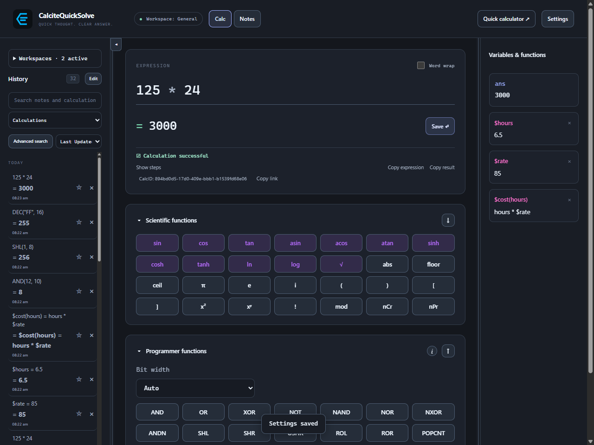
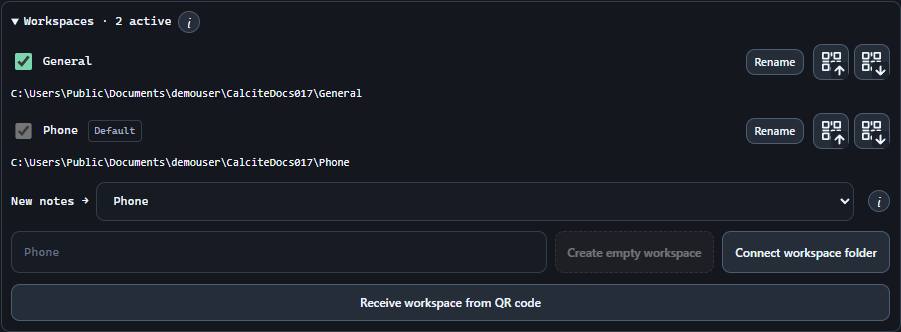
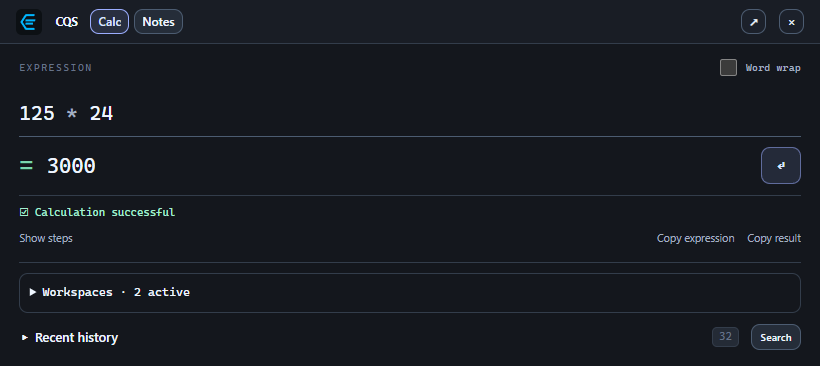
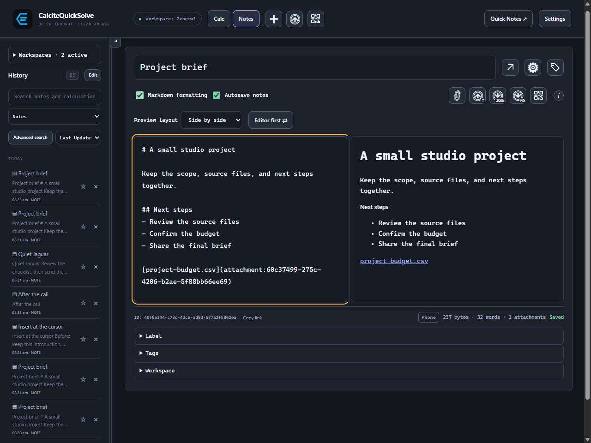
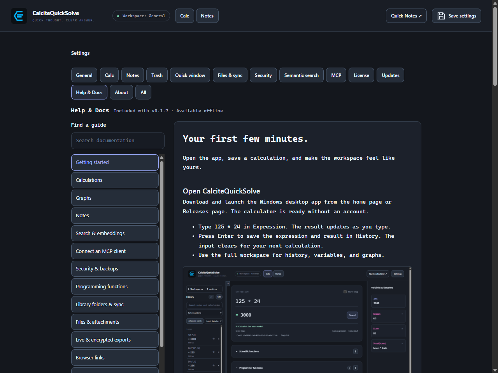

# Your first few minutes.

Open the app, save a calculation, and make the workspace feel like yours.

## Open CalciteQuickSolve

Download and launch the Windows desktop app from the home page or Releases page. The calculator is ready without an account.

- Type 125 * 24 in Expression. The result updates as you type.
- Press Enter to save the expression and result in History. The input clears for your next calculation.
- Use the full workspace for history, variables, and graphs.

## Choose a home for your notes

Keep your notes in General, or create separate workspace folders for different projects and devices.

- Open Settings → Files & sync → Workspaces to create or connect a workspace. Activate one or more and choose the New notes default.
- Share only the complete workspace folders you want on another device using your sync tool. Keep files available offline.
- The workspace bubble beside a note’s byte count shows where it belongs. Choosing a folder does not start the Notes trial.

[Set up a library and a second computer](sync.md)

## Keep Quick Calc nearby

Press Ctrl + Alt + Space to open the small calculator from your desktop. Press Escape when you are finished. You can customize shortcuts in Settings.

- Enter saves the calculation and clears the quick input.
- Ctrl + Shift + C copies the result.
- The arrow keys recall earlier expressions; Ctrl + L clears the input.

> On a fresh installation, the first launch enables Start with Windows so the app starts in the tray when you sign in. Change it in Settings → General → Desktop and save your settings. Existing users keep their saved choice. With startup off, open CalciteQuickSolve manually before using global shortcuts. Closing the window keeps the app in the tray; Quit stops the shortcuts.

## Choose what a tray click does

Open Settings → General → Desktop and set Tray left-click, then choose Save. Right-click always opens the tray menu.

| Left-click choice | What opens |
| --- | --- |
| Menu | The existing tray menu. This is the default. |
| Calc | The full calculator window. |
| Notes | The full Notes window. If Notes is unavailable, the calculator opens instead. |

> Closing the main window keeps CalciteQuickSolve running in the tray. To exit, use Quit at the bottom of any settings category. The confirmation warns that global shortcut keys will no longer work until you launch the app again. Choose Cancel to keep it running, or Save and quit to save your settings and current note before exiting.

## Try Notes

Open Settings → License and start the 30-day Notes trial. Switch to Notes, choose New note, and give your note a title.

> Notes is a $19.00 USD one-time upgrade, with a 30-day trial. Scientific calculations and graphs stay free.

[Insert, attach, and import files](note-files.md)
[Set up live exports](note-exports.md)
[Trials and offline activation](licensing.md)
[Open Notes and calculations from browser links](browser-links.md)

## Choose how to update

Settings → Updates shows the current version and lets you check for a newer release. Preferences apply immediately. Automatic checks run at startup and every six hours while the app is open.

- Installed copies can choose Install now and reopen or Update on next restart. Update automatically downloads an eligible update in the background and installs it at the next app launch.
- Standalone copies can check for updates and open the website to download a replacement EXE.
- Update to betas is off by default. Turn it on, then click Check for updates to test beta releases. Beta users also receive newer production releases. Changing this option cancels queued updates; turning it off never downgrades the app. Older versions need a one-time manual installation to add this option.
- Turning off Enable updates stops checks, downloads, queued installation, and notifications. Automatic checks and notifications can also be controlled separately.
- Dismiss hides the current version's update notice until a newer version is found; the release remains visible in Settings.
- Closing the main window leaves the app running in the tray. A queued update waits until you quit and launch the app again.

## Choose what to enable

Settings contains themes, layout options, security, semantic search, and MCP access. Semantic search and MCP are both off by default; enable them only when you want those workflows.

- Enable semantic search to make Begin download and Import model folder available. Enabling alone never starts a download.
- MCP needs a configured vault and an unlocked UI to create agent grants.
- Choose a backup location and make a first export before building a large library.
- Settings → About shows the running executable’s path.

## Read the documentation in the app

Open Settings → Help & Docs. Search the bundled guides or choose a document from the list. Guides and screenshots are available offline; external links open your browser.

