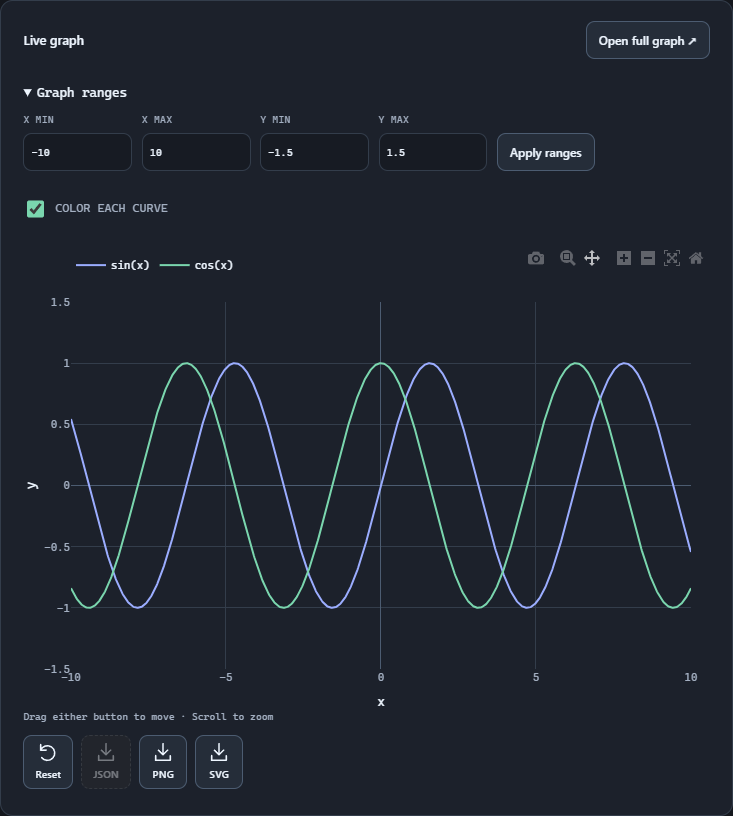
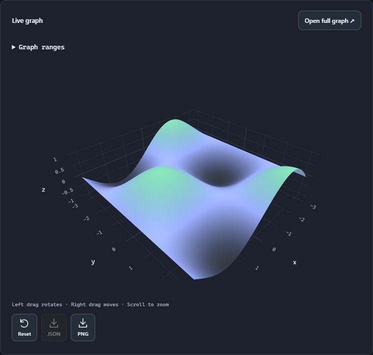

# From expression to picture.

Compare curves, explore a surface, and adjust the view without leaving the calculator.

<a id="plot"></a>

## Plot a pair of curves

Type this expression in the calculator. The live graph appears below the result and changes with the expression.

- Use bare x for the horizontal coordinate. Saved variables and custom function names still require $.
- The screenshot narrows the Y range so the sine and cosine curves are easy to compare.

```
plot(sin(x), cos(x))
```

> Use RAD for the usual sine and cosine curves in this example.



<a id="view"></a>

## Give the graph room

Choose Open full graph to inspect it in a larger view. Drag to pan, use the graph’s zoom controls, or set explicit minimum and maximum ranges.

- Adjust X and Y ranges, then apply them.
- Enable separate colors when comparing curves.
- Reset the view if a pan or zoom takes you away from the interesting part.

<a id="custom"></a>

## Plot a custom function

Save a function with a $ prefix, then use the same name in a plot expression. Its parameter is local to the definition; x is the graph coordinate in the plot.

```
$wave(t) = sin(t)
plot($wave(x))
```

> Enter the definition first. Keep built-in sin and plot bare; include $ in both $wave(t) and $wave(x).

<a id="surfaces"></a>

## Explore 3D

Type a surface expression using bare x and y coordinates. The live 3D view updates as the expression changes.

- Left-drag to rotate the surface; right-drag to pan.
- Scroll to zoom. Adjust X and Y ranges, then choose Apply ranges.
- Use Reset view to return to the default view.

```
plot3d(sin(x) * cos(y))
```



<a id="export"></a>

## Keep the result

Use the graph export controls to save an image. Workspace exports also preserve saved graph definitions, so the expression can be reused later.

> An exported image is a snapshot. Keep the graph definition when you want to edit the underlying expression again.
