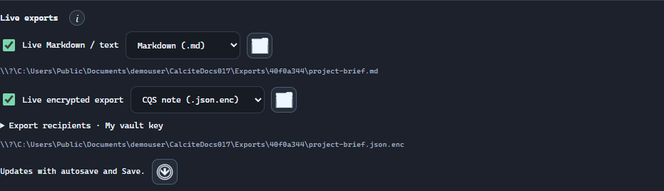
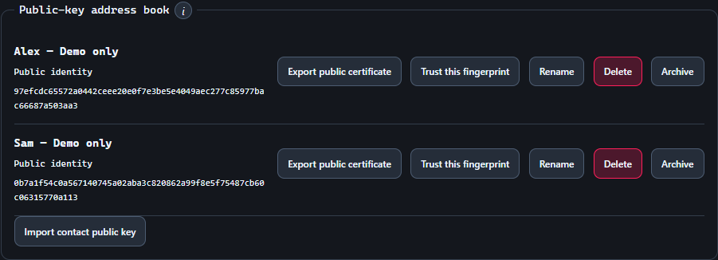
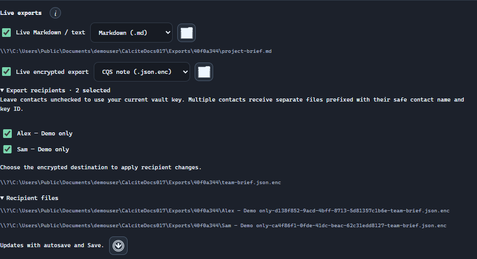

# Keep exports up to date.

Set up a live Markdown or text copy, encrypt a separate export for your vault or contacts, and understand exactly when files refresh.

<a id="overview"></a>

## Understand the two destinations

Live disk exports are available in the desktop app under full Notes → Note options → Live exports. Android hides these controls because it cannot use desktop export destinations. Desktop can enable a plain destination and an encrypted destination together.

<a id="plain"></a>

## Set up a live Markdown or text file

Check Live Markdown / text to enable the destination. Its format selector appears below the checkbox only while enabled. Choose Markdown or Plain text and use Choose plain export destination to apply a changed format or location. A successful note save updates the configured file.



<a id="formats"></a>

## Choose the right payload

Export note JSON and Export text create one-time copies. Export text offers Plain text, Markdown, and custom extensions. Live exports refresh configured copies after saves.

| Format | What it carries | When to choose it |
| --- | --- | --- |
| CQS note / JSON | Structured note data and attachment bytes. Available for one-time export and encrypted live export. | Move a complete note back into CQS. |
| Markdown / MD | The body with referenced attachment bytes embedded as data links. | Keep Markdown content portable, including files/images for CQS re-import. |
| Plain text / TXT | The body, with attachment references replaced by labels. Markdown syntax may remain in the text. | Create a lightweight readable copy when attachment bytes are unnecessary. |

> Markdown applications differ in their support for embedded data links. TXT is not a complete attachment backup. The .enc suffix means the selected payload is inside an encrypted CQS envelope, not a file another editor can open directly.

<a id="vault"></a>

## Prepare your vault and keys

Encrypted live-export controls appear after the desktop vault is unlocked. Setting up the vault manages keys; it does not automatically encrypt every existing note.

1. Open Note options → Security & keys, or Settings → Security. If necessary, enter and confirm a master password and choose Enable Notes encryption.
2. Save the recovery key shown during setup somewhere you can recover separately from this computer. It is displayed only at setup.
3. Unlock the vault when prompted. The initial shared key provides your personal access key, which is used when Export recipients is left at My vault key.
4. Before relying on encrypted files for recovery, expand Encrypted key backup & transfer. Choose the keys to export, enter a backup passphrase of at least 12 characters, and choose Export encrypted keys. Keep that backup and its passphrase recoverable.

> An encrypted note export contains no private key. Another device needs the matching key material, typically restored using Import encrypted keys. The same master password in a newly created vault does not recreate the original key.

[Understand note protection and backups](security-and-backups.md)

<a id="own-key"></a>

## Encrypt a live export for your vault

Unlock the desktop vault, then check Live encrypted export. Its payload selector and recipient controls appear only while enabled. With no contacts selected, the active vault key is used. Choose the encrypted destination to apply a new format or recipient selection. The exported file remains encrypted; unlocking a note does not turn it into a plain export.

<a id="contacts"></a>

## Add a recipient’s public identity

Alex and Sam are example recipients in this walkthrough. Use each real recipient’s CQS public identity certificate when exchanging actual notes.

1. The recipient opens Security & keys, unlocks their vault, and expands Add a key or identity. They enter a name, choose Signing & encryption identity, and select Generate / add key.
2. The recipient selects Export public certificate for that identity and shares only the resulting CQS-public-identity JSON file. Their private identity and encrypted-key backup stay with them.
3. On your computer, open Security & keys → Public-key address book → Import contact public key and choose that public certificate.
4. Compare the displayed fingerprint with the recipient through a channel you trust. Only mark Trust this fingerprint after that comparison. Repeat for other contacts.
5. Return to the note. Non-archived contact public keys are now available under Export recipients.

> CQS certificates use Ed25519 and X25519 identities; they are not X.509/TLS certificates, SSH keys, or arbitrary PEM files. Importing a public certificate lets you encrypt for its owner; it does not give you their private key.



<a id="recipients"></a>

## Export separately for selected recipients

Choose contacts when the destination files should be opened by those contacts’ private identities. Up to 32 recipients are supported.

1. In Live exports, choose the encrypted payload format and expand Export recipients.
2. Select Alex and Sam (or the contacts you actually need). Leaving no contacts selected uses My vault key; selecting contacts replaces that default for this export.
3. Use the folder button labelled Choose encrypted export destination again to apply the selected recipients. Pick a new base filename such as project-brief.json.enc in an existing folder.
4. Confirm Live encrypted export is enabled. Save or select Update exports now, then expand Recipient files to inspect the actual paths.
5. With multiple recipients, CQS creates a separate file for each. The name is the safe contact name, key ID, and chosen base filename. With one recipient, it uses the selected base path directly.
6. Give each recipient their corresponding file using your chosen sharing method. They unlock the matching private identity in CQS, select Import notes, and import a new copy.

```
Example naming pattern for two recipients:
Alex-<key-id>-project-brief.json.enc
Sam-<key-id>-project-brief.json.enc
```

> These recipient files do not automatically add My vault key as another recipient. Retain your source note and key backup, or make a separate own-key export if you need one. Filenames can reveal contact names even though file contents are encrypted.



<a id="change"></a>

## Change the format, recipients, or folder

The format selector and recipient checkboxes prepare a choice. Re-selecting a destination applies that choice to the saved export configuration.

1. Change the desired format or contact selection.
2. Use the corresponding Choose … export destination folder button again, choose an appropriate filename and extension, and confirm it.
3. Keep the export enabled, then save or use Update exports now. Review the displayed path and Recipient files.
4. Open or re-import a test copy before treating the new destination as your working export. Disabling or reconfiguring an export does not remove older files from disk.

> Destinations cannot overlap one another or point into CQS application storage. For multiple recipients, CQS refuses to overwrite unrelated existing generated files; choose a new base filename. Changing a contact’s display name alone does not rename already configured outputs.

<a id="timing"></a>

## Save, pause, retry, and stop

A successful autosave or manual Save refreshes enabled destinations. With Autosave notes off, typing alone does not update them.

- Update exports now saves the current UI note if necessary and rewrites enabled exports. It is useful after reconnecting a drive or unlocking the vault.
- An export failure does not roll back a successful library save. “Note saved. Live export needs attention” means the note was saved but at least one external copy needs a retry.
- Uncheck Live Markdown / text or Live encrypted export to stop future updates to that destination. The last file remains on disk.
- An unlocked authorized MCP grant has its own vault access. UI locking alone does not revoke that grant; MCP-triggered operations follow its permissions.

> Live-export files are current copies, not an append-only history or a full library backup. Keep versioned backups when older content matters.

<a id="troubleshoot"></a>

## Resolve an export that needs attention

Read the error under the affected destination, then address that destination before retrying.

| Symptom | What to do |
| --- | --- |
| Encrypted controls are missing | Use full Notes in the desktop app and unlock the vault. Quick Notes hides advanced export and encryption settings. |
| Destination unavailable / cannot write | Reconnect the drive or make its folder available locally. Check folder access and choose a valid existing directory. |
| File did not change after typing | Save the note, or turn on Autosave notes. Check that the target checkbox is enabled. |
| New format or contacts were not applied | Choose the destination again after changing the selector or recipient checkboxes. |
| Missing or archived recipient key | Select an available contact key, re-choose the destination, and retry. Keep old matching private keys for existing files. |
| Generated filename collision | Choose a new base filename; do not overwrite an unrelated recipient file. |
| Export too large | Use a full library backup. Encoding and encryption overhead can exceed portable limits even when individual attachments fit. |

[Import the exported file](note-files.md)
[Folder sync and organizations](sync.md)
[Full library backups](security-and-backups.md)

<a id="sync-folder"></a>

## Use a folder managed by Syncthing, Google Drive, or OneDrive

Choose an export destination inside a folder Syncthing, Google Drive, or OneDrive is already configured to synchronize. CQS writes the local file; the external tool handles transfer and organizational access.

1. Choose or create the destination directory using your normal file manager and sync-client setup. Keep it available locally.
2. Configure the note’s plain or encrypted destination there and verify that a save updates it.
3. Wait for the sync client to finish before expecting the file on another device. Configure live-export destinations independently on each CQS installation.

> Live exports are one-way copies, separate from workspace folder sync. Editing an exported file does not change the source note.

[Set up an externally synchronized CQS library](sync.md)
