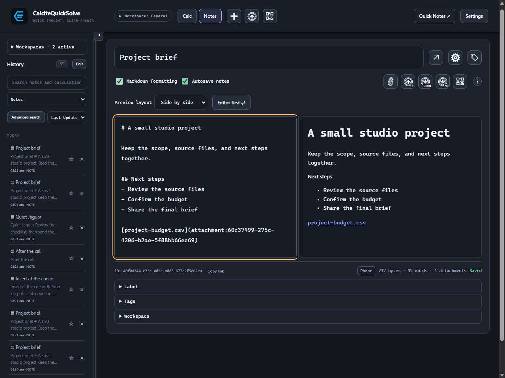
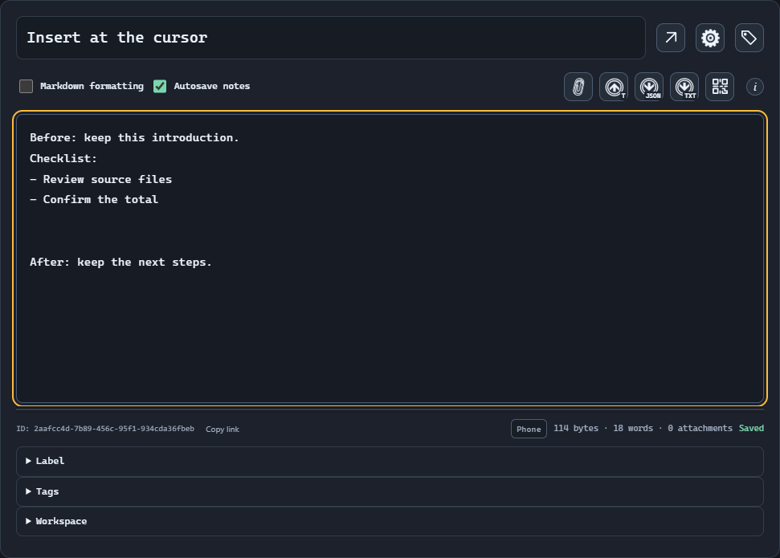
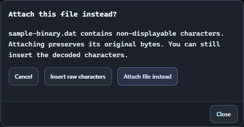
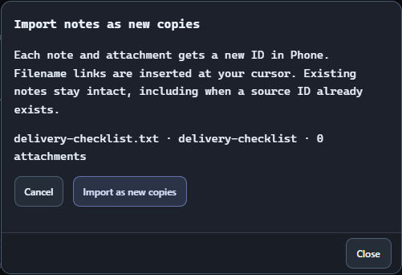
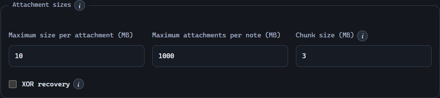

# Bring files into your notes.

Insert text at your cursor, preserve original files as downloadable attachments, or import documents as independent notes.

## Choose what should happen to the file

These actions have different results. The icon tooltips and accessible names use the labels below.

| Action | Result | Use it for |
| --- | --- | --- |
| Insert text from file | Decodes text into the current note, replacing the selected range. | A checklist, CSV, source snippet, or paragraph you want to edit. |
| Attach file | Stores the exact original bytes and inserts a downloadable filename link. | A PDF, archive, document, image file, or original source you want to preserve. |
| Import notes | Creates separate notes with new IDs; inserts filename links into an open note. | Importing CQS exports, Markdown, or plain text as separate notes. |

> Dropping a file onto Note text follows the insertion workflow. Use the paperclip when you already know you want an attachment. Pasted PNG, JPEG, GIF, and WebP images retain their image-preview behavior.

## Insert text at the cursor

The editor remembers the cursor or selected text while the file picker is open. Text before and after that selection remains in place.

1. Open a note and click in Note text at the insertion point. Select a phrase if you want the incoming text to replace it.
2. Choose Insert text from file (the import icon with a T badge), then select your file. You can also drop a file onto the text field after positioning the cursor.
3. CQS decodes UTF-8, or UTF-16 when the file includes a byte-order mark. Review the inserted text and its surrounding paragraph.
4. Wait for Saved with Autosave notes on, or use Save note / Ctrl+S. Inserting text does not keep a separate copy of the original file.

> The per-file limit is configurable in Settings → Notes. Text still must fit the 2,000,000 UTF-16 code-unit note limit. Files above 8 MB are offered as attachments instead of being decoded into the editor.

## Handle a file that is not ordinary text

If decoded content contains non-displayable characters, the insertion workflow asks “Attach this file instead?” before changing the note.

- Attach file instead preserves the exact bytes and adds a filename link. This is usually the useful choice for PDFs, archives, and other binary documents.
- Insert raw characters inserts the decoded characters. It may contain unreadable or replacement characters and is not a byte-preserving conversion.
- Cancel leaves that file out of the insertion.

> The prompt concerns inserting text into the current note. Use Attach file to preserve a binary file. Import notes creates separate notes from supported note files and rejects binary or invalid text.

## Attach an original file

An attachment is stored with the note, so downloading it later does not depend on the source file staying at its original location.

1. Place the cursor in Note text, or select the text that the filename link should replace.
2. Choose Attach file (the paperclip) and select one or more files. Empty files are supported too.
3. CQS inserts a link such as [project-budget.csv](attachment:UUID). In Markdown mode, the preview displays a clickable filename. In plain mode, downloadable filenames also appear below the editor.
4. Save the note and check its attachment count. Keep the link in the body where readers can find it.

> Attachments follow the note’s encryption, history references, backup, and Trash behavior. Other file types are downloaded; they are not executed or displayed as active content inside the note.

## Download an attachment again

Click the rendered filename link in Markdown preview, or its button below a plain-text editor.

1. Choose the attachment link you want to save.
2. In the desktop app, choose a destination in Save As and confirm the filename. Browser previews use the browser’s available file-picker/download support.
3. Open the saved file in the appropriate external application if you want to inspect it. CQS saves the attachment’s original bytes.

> A text-only export keeps attachment labels, not their contents. Keep a JSON bundle or Markdown export when you need attachments to travel with the note.

## Import files as separate notes

Import notes creates separate notes from validated CQS exports (.json or .enc), Markdown (.md or .markdown), or plain text (.txt). The picker filters these extensions. Unsupported files, unrelated or malformed JSON, and binary or invalid text are rejected. Use Attach file to keep other original files, or Insert text from file to copy their text into the current note.

1. In full Notes, open a note and place the cursor where links to the imported notes should go. You can also start from the empty Notes view.
2. Choose Create new note from file in the desktop Notes header, or the file-import action in the empty Notes view, and select one or more supported files.
3. Review “Import notes as new copies,” including the source filenames and attachment counts. Choose Import as new copies.
4. Find the new notes in History. Each note and attachment has a fresh ID, so an existing note is not overwritten even when the source has the same ID.
5. If a note was open, follow the newly inserted filename links from that note. If none was open, the first imported note opens. Save changes to any note receiving those links.

> CQS bundles preserve structured note data and attachments. Markdown exports with embedded file/image data reconstruct those attachments when imported. Only supported note files are accepted; use Attach file for a PDF.

## Save as text or Markdown

An opened note has one Export text button. Save As offers Plain text (.txt), Markdown (.md), and All files (*.*) for a custom extension. Markdown formatting selects .md by default; otherwise the default is .txt. Choosing .md or .txt selects that representation. A custom extension keeps the default representation.

> Export note JSON keeps structured note data. Markdown includes embedded attachments; plain text keeps their labels. Browser previews use the browser’s available file picker or download support.

## Send and receive notes by QR code

Open a note and choose Export note to QR code. To receive, choose Import note via QR in the desktop main app or Quick Notes header, or the QR import action in Android’s empty Notes view. Desktop transfers use a separate resizable window. Confirm completion on the receiver before choosing Done on the sender.

1. On the receiving device, select a camera and choose Begin. Camera access starts only after Begin and stops when reception completes or you close the screen.
2. First set up and unlock the receiving local vault. On the sender, choose Encrypt transfer and Password, then use the same transfer password on the receiver. Scanning continues during its password prompt, and a wrong password can be retried without rescanning. Vault mode instead needs an unlocked matching shared key or private identity. Including a workspace key is optional, requires Password, and works only when adding a new workspace.
3. Adjust QR data size or frame speed while sending. CQS keeps already received data when the size changes. Resize the transfer window and choose black or white surroundings as needed. A static preview appears before Begin; the QR grows to fill the available space without a fixed maximum size.
4. Watch the block display, transfer rate and frame count. The sending bar includes every QR frame, including Transfer details frames. Filled receiving blocks show received file data; missing blocks can arrive on later loops. B/sec averages file data over the last five seconds: repeated sends count, but duplicate receives and transfer details do not. The sender’s time estimate describes one display cycle, not confirmed delivery.
5. After all blocks arrive, review the note names and IDs. Confirm Import and merge. A matching note ID updates the existing note; conflicting versions are preserved as checkpoints and require a choice.

> Every receiver needs a configured, unlocked vault. Require encrypted QR transfers rejects plaintext input. New notes from password or vault encrypted transfers are encrypted on the receiving device; existing notes keep their local protection. Auto-lock pauses until the transfer ends, then the full timer restarts. Manual locking still stops the transfer.

[QR transfers: sending, receiving and troubleshooting](qr-transfers.md)

## Transfer a workspace

Open Settings → Files & sync → Workspaces. Use the QR icons with up/down arrows beside Rename to send or receive a workspace, or Receive workspace from QR code. Current and archived notes include attachments, tags and labels. Choose whether to include version history and Trash; both are off by default because they can make transfers larger and slower.

> Receive workspace from QR code adds or merges the incoming workspace by ID. The receive icon beside a specific workspace accepts only that same workspace ID; mismatches block import. Renaming does not change the ID. Missing notes stay in place. See the QR transfer guide for encryption, conflict review and troubleshooting.

[QR transfers: sending, receiving and troubleshooting](qr-transfers.md)

## Open an encrypted export

Encrypted .json.enc, .md.enc, and .txt.enc files are CQS-secure-note envelopes. They require the desktop app and a matching unlocked key.

1. Unlock the vault that contains the matching shared key or private identity. For a recipient export, a public certificate alone cannot decrypt the file.
2. Use Import notes and select the encrypted file. Leave its bytes intact; changing the extension does not decrypt it.
3. After CQS decrypts and validates the payload, review the import preview and choose Import as new copies.
4. Check the imported copy’s protection. Portable import creates a new note and does not automatically apply the source note’s encryption settings; use Note options → Encryption & signing if the new copy should be encrypted.

> If the key is missing, obtain the intended key backup or ask the sender to export for your public identity. The file cannot be opened with the sender’s public certificate or an unrelated vault password.

[Create and receive encrypted exports](note-exports.md)

## Set attachment sizes

Settings → Notes → Attachment sizes uses MB (1 MB = 1,000,000 bytes). Information buttons explain the details.

- A file attachment can be larger than 25 MB or 100 MB. It is split into bounded chunks.
- Large files or many attachments can slow or temporarily freeze the app.
- Lower limits apply to new additions; existing attachments remain readable and editable.
- Save a large attachment separately or back up the library folder when it cannot fit a portable bundle.

| Setting | Default / behavior |
| --- | --- |
| Maximum size per attachment | 10 MB; increase it for larger files. |
| Maximum attachments per note | 1,000 MB total, with up to 100 attachments. |
| Chunk size | 3 MB; configurable from 1 to 25 MB per stored chunk file, including encoding and encryption overhead. |
| Portable note import/export | A separate 50 MB bundle limit and encoded-size checks still apply. |

## Optional XOR recovery

Enable XOR recovery in Attachment sizes to add one recovery chunk to new attachments.

- Any one missing or damaged data chunk can be reconstructed from the remaining data chunks and the recovery chunk. Losing only the recovery chunk leaves the file readable.
- The manifest and all other chunks must remain available. Two missing chunks cannot be recovered.
- When the note is encrypted, every data chunk, its manifest, and the recovery chunk are encrypted independently.
- Recovery happens when reading or downloading; damaged source files are not overwritten automatically. Back up or synchronize the entire library.
