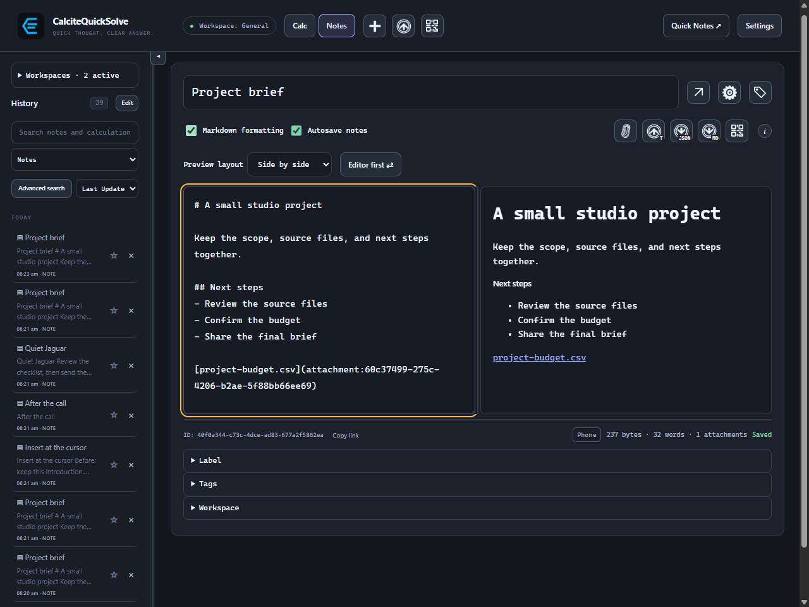
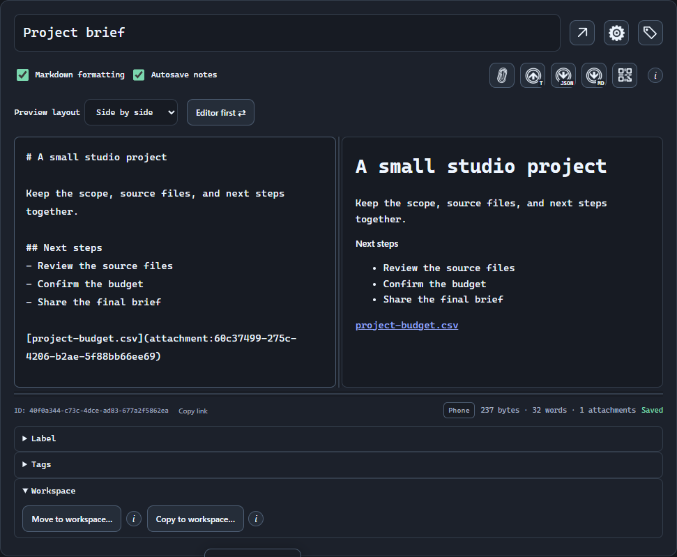
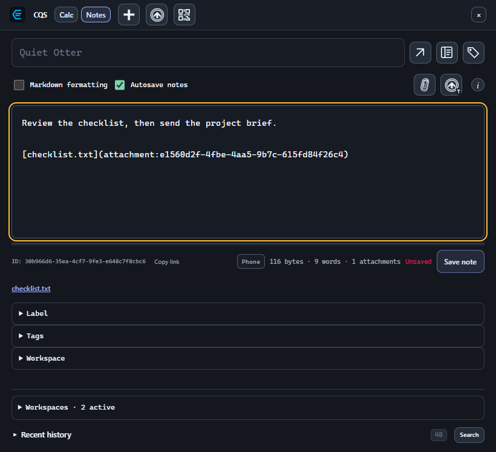
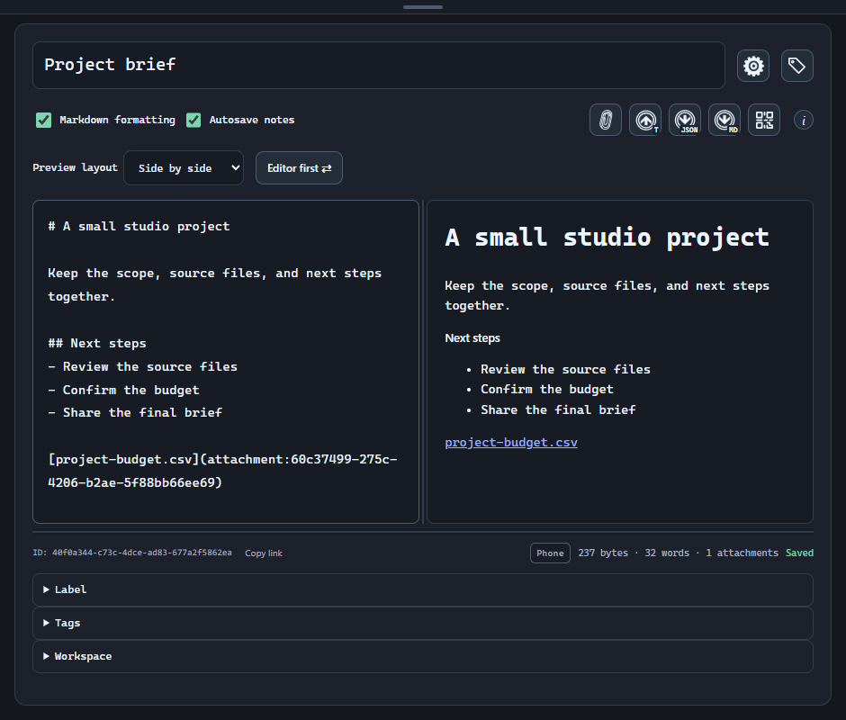
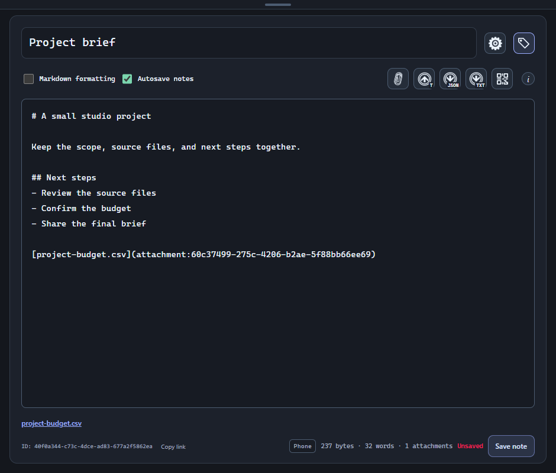
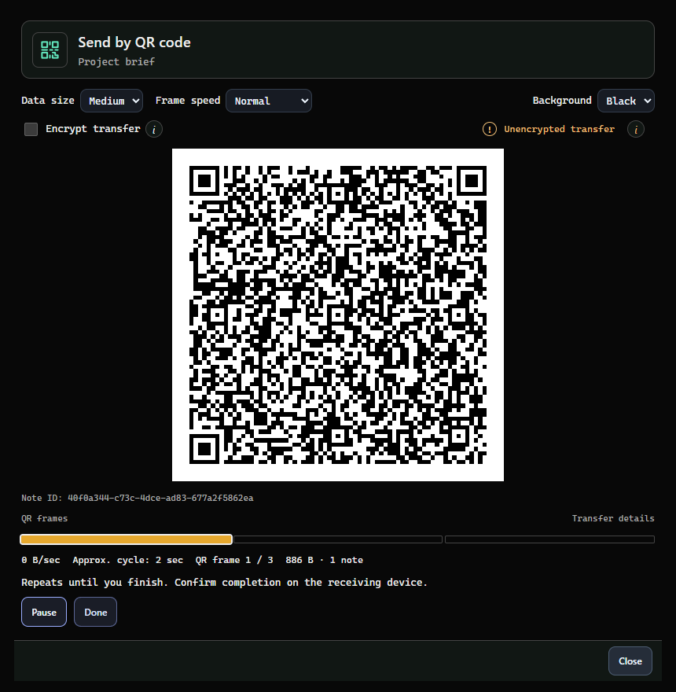

# A notebook for the context.

Write and organize notes, keep files with them, and maintain plain or encrypted exports on your device.

## Tab in note text

Tab inserts a literal tab in note text by default, replacing selected text when applicable. Shift+Tab removes a tab immediately before an empty selection. Ctrl+Tab moves to the next focusable control; Ctrl+Shift+Tab moves to the previous one. Undo and redo work with these text edits. Turn off Tab inserts a tab in note text in Settings → Notes to restore ordinary Tab navigation.

## Create a note

Switch to Notes and choose New empty note (plus) in the main app or Quick Notes header. The adjacent buttons create a note from a file or import one by QR. Enter a title and body. Notes are available with Full or the 30-day trial started from Settings → License.

- Enable Markdown formatting for headings, lists, emphasis, code, and a formatted preview.
- Use Attach file to keep an original document with the note, or Insert text from file to copy its text into the editor at the cursor.
- Open a note in its own window when you want it beside another task.

## Save and organize

Autosave keeps edits moving; watch the save status before closing the app. Manual-save workflows also retain draft recovery. Tags, labels, and pins make a growing notebook easier to navigate.

## Choose or change a note’s workspace

The workspace bubble beside the byte count identifies the note’s destination or owner. Expand Workspace below Tags to choose where a new note will be saved.

- Before the first save, Choose workspace changes the destination, including any draft attachments. This selector disappears after the note is saved.
- After saving, Move to workspace transfers the note, its attachments and retained history. Copy to workspace creates independent note and attachment IDs.
- QR workspace transfers preserve the workspace ID. A display name is local to the device and does not change that identity. Use matching manifests when connecting a synchronized folder.

## Reopen separate note windows after startup

Open Settings → General → Desktop, enable Reopen popped-out notes on startup, and save settings. This option is off by default.

- Leave the note windows you want to restore open when quitting the app or shutting down the PC. Closing an individual note window removes it from the next restoration. Notes also reopen when the app starts in the background; Start with Windows separately controls automatic launch when signing in.
- The app remembers each window's last saved size, position and maximized state. If its monitor is unavailable, it fits the window to an available monitor.
- On Windows, the app also tries to restore the saved virtual desktop. If that desktop was removed or is unavailable, the note opens on the current desktop.
- Encrypted notes reopen with Unlock vault and no note title or content. Choose Unlock vault to open Security settings; after unlocking with the required keys, the note and any recoverable draft load in the same window.

> Window restoration is separate from saving or backing up a note. It uses the notes and recovery data already on this computer. Window arrangements stay local to each library and device; restoring a window does not recreate a missing note.

## Keep Quick Notes small

Quick Notes supports Attach file, Insert text from file, and dropping files onto the text field. Its window stays open while a file picker or attachment operation is active.

- The header contains New empty note, Create new note from file, and Import note via QR. Open full Notes appears once, beside the note title.
- Open Search in Recent history to find a note or calculation. Long result lists expand into the available window space before scrolling; short lists stay compact.

1. Open Quick Notes and create or open a note.
2. Place the cursor where the file link or text belongs, then use the paperclip or insertion icon. Hover to check the label.
3. Choose the library icon (Open full Notes) to save the current note and continue in the main editor. The separate diagonal arrow opens the current note in a popout.

> Advanced encryption and live-export configuration are intentionally kept in full Notes. Their absence in the quick window does not remove existing note protection.

## Find an earlier idea

Search notes in the active workspaces using words from their titles or text. Results identify the workspace. Use Advanced search for combinations of rules, or enable semantic search for related matches.

> Locked protected notes are not part of the UI’s accessible search index. Unlock them before indexing or searching their contents.

## Follow an externally updated note

Complete synced changes apply while a note is open, including while you type. CQS merges compatible saved and unsaved changes and adjusts the cursor, selection direction and scroll position for text inserted or removed before the selection.

- Use the refresh icon beside History to force a folder scan and refresh the open note after your sync app finishes.
- If changes overlap your unsaved draft, CQS preserves the draft and shows a notification. Review the saved versions or save a separate copy before discarding anything.
- If the cursor cannot be kept in the same text reliably, an in-app notification explains that the note changed or was merged. Check the updated text before continuing.

## Recover an earlier version

Note options → Version history shows frozen saved versions. Basic Save / Ctrl+S saves the note and creates a checkpoint. Advanced mode separates saving Current from Create checkpoint and allows a checkpoint message.

- Restoring a version preserves the previous Current. Other saved versions retains originals after conflicts and history edits.
- Advanced mode adds amend, squash-through-Current and reset with confirmation. The main-timeline limit controls displayed checkpoints; referenced and alternate history is retained.
- A ! beside the star in History or Search opens that note’s conflict review. My version, Received version and Advanced Base have bordered text panels. Long notes show disputed sections with context; Show full versions expands the originals. The combined result always contains the full note.
- Trash can restore deleted notes. Permanent deletion is a separate confirmed action; a concurrent unseen edit remains a conflict rather than being silently discarded.

## Export or share

Use Export note JSON for a structured copy, or Export text to choose Plain text, Markdown, or a custom extension. The default text format follows Markdown formatting. Export note to QR code sends the saved note to another device. Full Notes also has per-note live exports under Note options.

> Plain exports stay readable even if the source note is encrypted. Select Live encrypted export when the file itself needs encryption.

[Files, attachments, and import steps](note-files.md)
[Set up live and encrypted exports](note-exports.md)

## Open and reuse a note window

The diagonal-arrow button beside the note title opens a separate note window. Popouts show Note options and Note metadata beside the title, without the main app’s create/import toolbar. Taskbar titles show the note name.

- Opening the same note again selects its existing tab, brings the window to the current screen, and centers and focuses it.
- Settings → Notes → Opening notes can allow multiple windows of the same note. All copies share live edits.
- Opening Notes from a global shortcut or tray action preserves the previous draft and starts a fresh note by default. Turn off Create a new note when opening Notes from a hotkey or tray to continue the previous note. Direct links still open the requested note.

## Show or hide labels and tags

Choose the tag icon beside Note options to hide or show metadata. Its tooltip is Note metadata. The choice is saved per note on this device. Settings → Notes → Collapse metadata in new notes controls the starting layout for new notes, including Quick Notes; existing per-note choices are preserved.

- With metadata hidden, the editor extends to the bottom of the window.
- The ID, Copy link, workspace bubble, raw text byte count, word count, attachment count, and save status remain visible.
- The byte count measures the stored UTF-8 note text, including whitespace and Markdown syntax. Attachment bytes are separate.

## Transfer notes and workspaces by QR

Send a note or an entire workspace through a repeating sequence of QR codes. Both devices use CalciteQuickSolve; a camera on the receiving device reads the sender’s screen. No hosted transfer service is needed.

- Workspace transfers include current and archived notes, attachments, tags and labels. History and Trash are optional. Protected workspace keys travel encrypted; local vault master keys, device credentials, settings and search indexes are excluded.
- QR import preserves note IDs and can update an existing note. Missing notes are not deleted. Conflicts require review and preserve versions as checkpoints.
- Every receiver needs a configured, unlocked vault. New notes from encrypted QR transfers are encrypted on the receiving device; existing local protection is retained. Protected workspaces carry their own encrypted key.
- Files & sync can require encrypted QR transfers. Receiving always requires an unlocked local vault. Auto-lock pauses through transfer and review, then restarts when you finish or cancel.
- Receiving stops the camera when the transfer completes, closes, fails, or the vault locks.

1. In full Notes, choose Export note to QR code. To receive a note, choose Import note via QR in the main app or Quick Notes header. For a workspace, use the send/receive QR icons in Settings → Files & sync → Workspaces.
2. Choose Encrypt transfer to protect it with a transfer password, or choose Vault when available and select a shared key or recipient. The receiver needs the same transfer password or the matching vault key.
3. On the receiver, select a camera and choose Begin. Keep the sender’s QR display in view until the transfer completes. Resize the transfer window or adjust the frame size and speed if scanning is slow.
4. Review the validated notes and any conflicts before importing. Confirm completion on the receiving device, then choose Done on the sender. The sender repeats the QR cycle until you stop it.

> Sending progress measures a display cycle, not confirmed delivery. Check the receiving device before closing the sender.

[QR transfers: sending, receiving and troubleshooting](qr-transfers.md)

