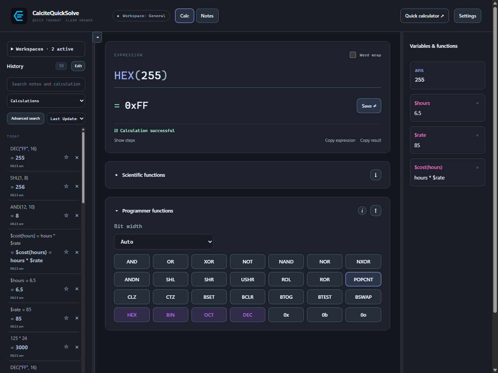
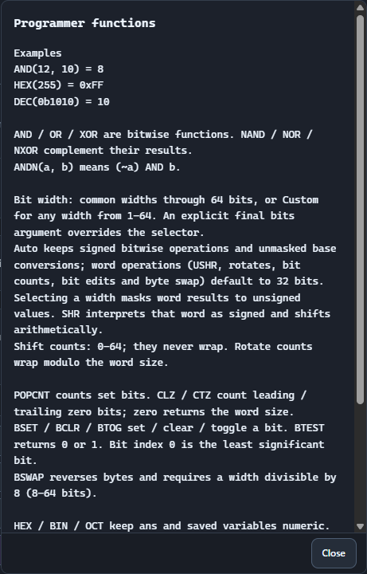

# Bits, masks, and number bases.

Use the Programmer functions panel beneath Scientific functions, or type the same operations directly into an expression.

<a id="bits"></a>

## Combine and inspect bits

Expand Programmer functions, which starts collapsed beneath Scientific functions. Both panels remember their open state; the up/down controls swap their order. AND, OR, XOR, and NOT work with exact integers. These examples return 8, 14, 6, and 240.

```
AND(12, 10)
OR(12, 10)
XOR(12, 10)
NOT(15, 8)
```

> Built-in calls are case-insensitive: and(10, 12), And(10, 12), and AND(10, 12) all return 8. The infix form 10 and 12 is a Boolean operation. With Bit width set to Auto, NOT(n) is a signed complement; choose or supply a width for an unsigned word complement.



<a id="word-width"></a>

## Set the word width

The Bit width selector offers Auto, 8, 12, 16, 24, 32, 48, 64 and Custom. Custom accepts 1–64 bits; invalid input leaves the last valid width active. The choice is saved and also available under Settings → Calc for Quick Calc.

- Auto keeps signed bitwise arithmetic and unmasked base conversions. Unsigned word operations default to 32 bits.
- Choosing a width masks word results to that unsigned width. SHR interprets the selected word as signed, while USHR interprets it as unsigned.
- An optional final bits argument overrides the selector, for example NOT(0,64) or HEX(-1,64). DEC's optional second argument is still the input base.

<a id="help"></a>

## Open the built-in reference

Select the information button beside Programmer functions to see examples on separate lines, followed by guidance on signed operations, optional word sizes, conversions, and exact integer limits.

> Press Escape or click outside the popup to close it. The function panel can stay open while you refer to the examples.



<a id="shift"></a>

## Shift a value

SHL shifts left without wrapping. SHR performs a signed arithmetic right shift. USHR treats the input as an unsigned word before shifting; its word width defaults to 32 bits.

```
SHL(1, 8)
SHR(-8, 1)
USHR(-1, 1, 8)
```

> With Bit width set to Auto, these examples return 256, -4, and 127. Shift counts must be integers from 0 to 64; explicit word sizes must be from 1 to 64. Shift counts never wrap.

<a id="bases"></a>

## Convert between bases

HEX, BIN, and OCT format a value with a base prefix. DEC converts prefixed values or quoted digits in an explicit base back to decimal.

```
HEX(255)
BIN(10)
OCT(493)
DEC("FF", 16)
HEX(-1, 8)
```

> The results are 0xFF, 0b1010, 0o755, 255, and 0xFF. An optional width formats the unsigned word representation; it does not pad with leading zeros.

<a id="limits"></a>

## Keep integer calculations exact

Programmer functions accept exact signed and unsigned 64-bit integers, from −9,223,372,036,854,775,808 through 18,446,744,073,709,551,615. Fractional and out-of-range inputs or results are rejected. Large integer results retain every bit in arithmetic, ans, saved definitions, and backups.

- Use 0x, 0b, and 0o prefixes for hexadecimal, binary, and octal literals.
- DEC with an explicit base accepts bases 2 through 36.
- HEX(2^64-1) returns 0xFFFFFFFFFFFFFFFF; HEX(-1,64) returns the same unsigned word representation.
- The same engine functions can be used through authorized MCP calculation tools.
