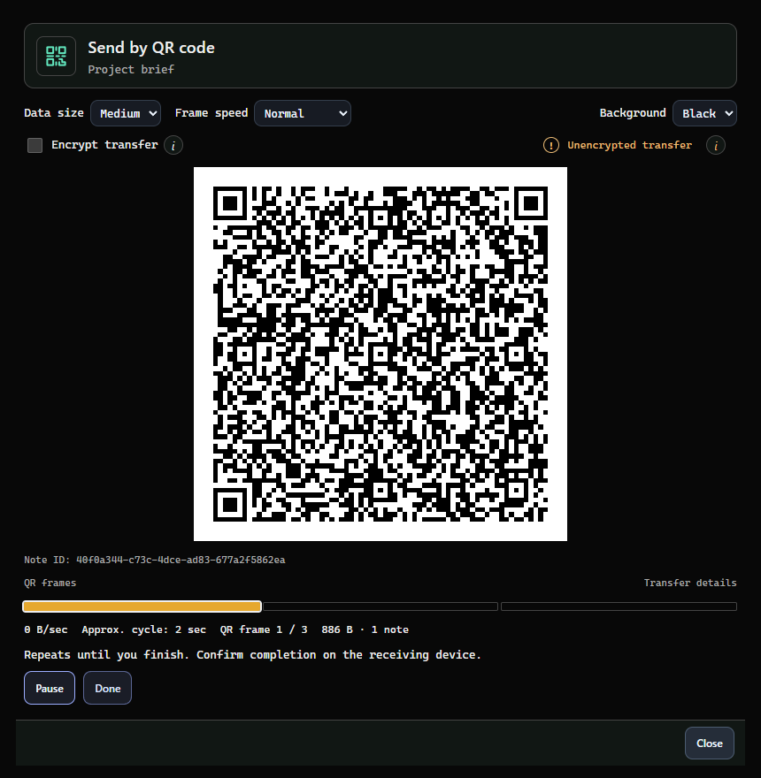
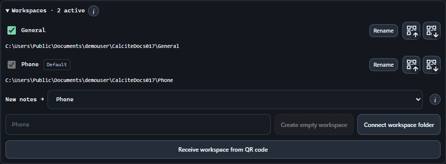

# Move notes from screen to camera.

Send a note or workspace, protect the transfer, and review incoming changes before importing.

## Before you start

Use CalciteQuickSolve on both devices: one displays a repeating sequence of QR codes and the other reads it with a camera. This is a one-time transfer, not continuous folder synchronization.

- Notes requires an active trial or Notes license. Save your work before starting; opening a note transfer saves that note.
- Set up and unlock a local vault on the receiving device before Begin. CQS rejects receiving and importing without one. It does not create a vault from incoming QR data.
- Allow camera access on the receiving device. The camera starts only after Begin and stops on completion, closing the transfer or vault locking.
- Anyone who records an unencrypted QR sequence can read it. Choose password or vault encryption before Begin when the contents need protection.
- Auto-lock pauses from transfer preparation through review/import. The full timer restarts on completion or cancellation. Manual locking still cancels the session; finish or close transfers when done.

[Notes and licensing](licensing.md)
[Android preview: supported features and limits](android.md)
[Workspace, vault and note keys explained](keys-and-encryption.md)

## Send one note

Open the saved note you want to transfer.

1. Choose Export note to QR code in the note toolbar. On desktop, a separate resizable transfer window opens.
2. Select Encrypt transfer if needed. Password is selected by default; enter a transfer password. For Vault, unlock the vault and choose a shared key or recipient.
3. Choose Begin. Keep the QR display visible to the receiving camera. Pause stops the sequence temporarily and enables < and > to move one frame. Select a frame bar to jump to that exact frame. Resume continues from the selected frame.
4. Wait for Transfer complete on the receiving device, then choose Done on the sender. A completed sending cycle does not confirm delivery.

## Receive and import a note

On desktop, choose Import note via QR in the main Notes or Quick Notes header. In Android’s empty Notes view, choose the QR import action.

1. Create and unlock your local vault in Settings → Security. Keep it unlocked until import finishes.
2. Select the receiving camera. If you know the transfer is protected, select Encrypted transfer and enter the same password, or unlock the vault containing the matching key.
3. Choose Begin and grant camera permission if asked. Keep the entire QR code, including its white border, in view. Leave the sender running while missing blocks arrive on later cycles.
4. For a password transfer, enter the password when prompted. Scanning continues while that prompt is open. If the full transfer has arrived, correct a wrong password and choose Decrypt and review without rescanning.
5. Review the note titles, IDs, attachments and version counts. Resolve every conflict, then choose Import notes for new notes or Import and merge for matching notes. Cancel confirms before discarding received data, even without conflicts. Choose Scroll down to import to keep your choices and return to the Import button.
6. Wait for Transfer complete, close the receiver, and tell the sender it can choose Done.

> QR import preserves note IDs and can update matching notes. File import creates new copies with fresh IDs. Choose the workflow that matches whether you are updating an existing note or making a separate copy.

## Transfer a workspace

Open Settings → Files & sync → Workspaces. Create, Connect and Receive are different actions: Create starts an empty workspace; Connect opens an existing folder; Receive imports a QR transfer.

- Notes absent from the transfer are not deleted.
- Transfer workspace key includes only this workspace’s password-encrypted shared key. A mixed workspace stays mixed; including the key does not turn on whole-workspace protection. Protected workspaces also carry their storage-protection bundle. Sharing requires an unlocked vault and a nonempty transfer password, including biometric-only vaults. Device vault master keys, private identities, settings and search indexes are excluded.
- Active workspace selections and the default destination remain local. Check which workspaces are active and where new notes will be saved after import.
- For a new workspace, choose Add workspace and then Import workspace to save its key into your unlocked local vault. Existing workspaces with notes or keys reject incoming workspace keys without importing them; a completely empty, keyless workspace left by an unfinished import can accept a retry; ask the sender to disable Transfer workspace key and use Password to merge notes. QR sharing does not change the original workspace password used by folder sync.
- Use the current app build on both devices for key sharing without whole-workspace protection. Earlier builds may reject that handoff with Missing workspace vault bundle; update the receiver and retry.

1. On the sender, choose QR Export <name> beside the workspace. Current and archived notes, attachments, tags and labels are included. History and Trash start off. A workspace key can exist without whole-workspace protection: create it in Settings → Security. To share that key with a new workspace, select Transfer workspace key and use Password encryption. Its transfer password can differ from other passwords. Leave key sharing off when merging into an existing workspace.
2. On the receiver, choose Receive workspace from QR code to add an incoming workspace or merge it by its identity. For a new workspace, enter its local name and choose Private or Shared folder, then Add workspace. Shared folder opens a parent-folder picker; after choosing a folder, click Add workspace again to select the destination. The folder is created only when Import workspace is pressed.
3. To update a specific existing workspace, use its Receive by QR icon. This checks the workspace ID. If it differs, use Add workspace in the review to create the incoming workspace, or choose Use existing workspace when that ID is already connected. The originally selected workspace stays unchanged. Individual-note transfers cannot update an entire workspace. Names may differ because renaming is local.
4. Begin the transfer, review its changes and resolve conflicts. Choose Import workspace for a newly added ID, or Import and merge for an ID already on this device. Verify completion before stopping the sender.

[Workspaces and folder synchronization](sync.md)

## Choose transfer protection

Transfer encryption and note storage encryption are separate choices. A workspace can have a dedicated shared key for QR transfers and optional note encryption without protecting every note. Every receiver needs an unlocked local vault. Sharing the workspace key itself requires Password encryption.

- Passwords are not saved. Selecting Encrypted transfer on the receiver rejects plaintext input for that session.
- Require encrypted QR transfers in Files & sync is off by default. It rejects plaintext transfers on this device and also requires an unlocked sender vault. Receiver vault setup and unlock are always required.
- Once a vault exists, unlock it to change that device-wide requirement in either direction.
- A QR transfer password protects this transfer, including its additional workspace-key envelope. It neither replaces nor changes the workspace password or either device’s local master password.

| Choice | What the receiver needs | Protection after import |
| --- | --- | --- |
| Password | An unlocked local vault and the exact transfer password. | Plain incoming notes remain plain in a mixed workspace; explicitly encrypted notes stay encrypted. A protected destination encrypts every note. Existing notes retain their local protection. |
| Workspace key / Vault key | The matching key already saved in an unlocked local vault. | Workspace transfers use only their own workspace key, with no fallback to the PC’s Notes storage key. This encrypts the transfer without sending the key or changing which notes are encrypted. |
| Unencrypted | A configured, unlocked local vault; no transfer password. | Available only for unprotected outgoing content. Anyone capturing the sequence can read it. A protected destination encrypts imported notes; otherwise new notes remain plain. |

[Vaults, keys and backups](security-and-backups.md)

## Review updates and conflicts

Nothing is imported until the complete transfer validates and you confirm its import. New workspace IDs use Import workspace; existing workspace IDs use Import and merge.

- Identical content is skipped. Newer incoming content updates the note; older content is kept as a checkpoint while your newer note stays current.
- For a conflict, choose Keep current; save incoming checkpoint or Use incoming; preserve both checkpoints. Import stays unavailable until every conflict has a choice.
- A review can become stale if a note changes meanwhile. Choose Refresh review and assess the updated choices.
- If a multi-note import fails partway through, earlier completed imports may remain. Review the transfer again; matching content is skipped.
- Attachment limits on the receiver still apply. Live-export errors are reported separately from a successfully imported note.

## Read progress and adjust scanning

The sender loops until you choose Done. It has no return acknowledgement from the receiver.

- Small, Medium and Large change how much data each QR frame contains. Slow, Normal, Fast, Super fast and Max control the display rate. Adjust these while sending; CQS retains already received data across size changes.
- Resize the desktop transfer window to enlarge the code, or choose black or white surroundings. Keep the full white border visible and in focus.
- Transmitted QR frames includes Transfer details and File data. Received blocks stay visible on Android and show file data already collected; missing blocks can arrive on another loop. Processing… replaces the camera after capture finishes while the transfer is prepared for review.
- Waiting for transfer header means the receiver needs transfer details. Keep the sender running so those frames repeat.
- B/sec averages file data over five seconds. Repeated sends count, duplicate receives do not. The sender’s estimate is one display cycle, not the time until the other device confirms import.

## If a transfer stalls

Keep the sender running while checking the receiving device.

| What you see | What to do |
| --- | --- |
| Set up and unlock your vault before receiving | Open Settings → Security on the receiver, create or unlock its local vault, then reopen the transfer. Auto-lock pauses while the transfer is active. |
| No camera or a permission error | Allow camera access in your operating system, close other apps using the camera, then use Choose camera again. |
| No QR detected or progress stops | Keep the whole code in focus, reduce glare, move the camera closer or farther away, enlarge the sender window, reduce QR data size, or choose a slower speed. |
| Android detects a QR but cannot read the transfer | Red means searching; amber means a QR was detected; green means a valid transfer frame. Hold steady and try Scanner options → Compatibility if recognition stalls. |
| Incorrect password | Enter the same transfer password used by the sender. Once all data has arrived, retry Decrypt and review without scanning again. |
| Workspace identity mismatch | Add the incoming workspace from the review, choosing its name and private or shared storage, or use its existing workspace. Shared storage requires Add workspace again after the folder picker. Renaming does not change its ID. |
| Import and merge is unavailable | Resolve every conflict, unlock required keys, and check for a workspace mismatch or validation error. Refresh a stale review before importing. |

> Closing a transfer releases its session and camera. Finish the import before closing; the sender cannot tell whether it succeeded.
