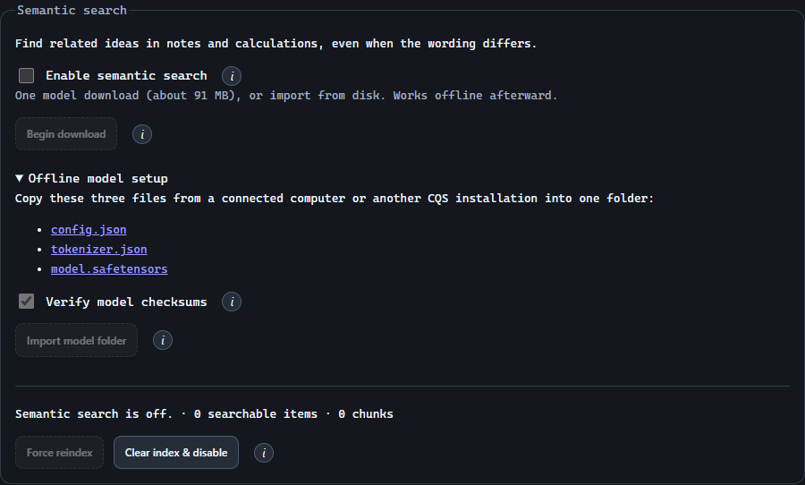

# Search by words or meaning.

Keep precise filters, add related results, and control the local semantic index.

<a id="enable"></a>

## Enable search and choose a model

Open Settings → Semantic search and select Enable semantic search. This makes the download and import controls available without starting a network transfer. If a model is already on this device, it loads automatically.

- Choose Begin download for the recommended model, or expand Offline model setup and choose Import model folder for files you already have. Once a model is available, indexing and search run on your device.
- Your search queries and note contents are not uploaded for embedding.
- The model is primarily English. Use exact search for precise identifiers, numbers, and languages it handles less well.

<a id="download-model"></a>

## Start or cancel a model download

Choose Begin download to fetch the approximately 91 MB all-MiniLM-L6-v2 model from Hugging Face. The button changes to Cancel download during the transfer. Downloaded files always have their recommended checksums verified.

- Cancel download interrupts the transfer, including a stalled connection, and removes the incomplete file.
- Completed files stay available for reuse when you choose Begin download again.
- Disabling semantic search also cancels an active download.
- Downloads never resume automatically after restarting CQS. Begin another download explicitly if files are still needed.

> The information button beside the download control explains this behavior. A complete existing model loads without another download.

<a id="offline"></a>

## Set up without internet access

Enable semantic search, then expand Settings → Semantic search → Offline model setup. Prepare one folder containing these three files:

- On a connected computer, download the three files linked in Offline model setup, or copy them from a working CQS installation.
- Transfer that folder to the offline computer, for example on a USB drive. Keep all three files directly inside the selected folder.
- Finish or cancel any active model download before importing.
- Leave Verify model checksums selected to require the recommended revision, or turn it off for compatible local files with different checksums. Choose Import model folder and select the prepared folder.
- Indexing pauses while CQS replaces the model and resumes afterward while semantic search remains enabled.

```
config.json
tokenizer.json
model.safetensors
```

> Import requires enabled search but uses no network. CQS keeps its own device-local copy for offline launches, so the USB drive is no longer needed after a successful import.



<a id="model-checks"></a>

## Choose checksum verification

Verify model checksums is on by default and optional for a local import. Turn it off if you intend to use compatible files whose bytes differ from the recommended revision. This choice stays with the imported model after restarting CQS.

- Compatible MiniLM-L6 BERT models with 384-dimensional embeddings are supported. Other model architectures or formats cannot be loaded through this setting.
- Even with checksum verification off, CQS validates file sizes, architecture, tokenizer, tensor loading, and a sample embedding.
- Files fetched with Begin download always verify the recommended checksums.
- Model fingerprints keep vectors from different model files separate. The affected index is rebuilt for the selected model.

> A failed import leaves the previous model selected. Missing or invalid imported files produce an error rather than silently downloading a replacement.

<a id="regular"></a>

## Use regular search

Search the active workspaces. Exact matches appear first, followed by related results ranked by semantic similarity. Type and tag filters continue to apply, and note results identify their workspace.

- The index uses note titles, text, tags, and labels.
- Saved calculation expressions and results can also be indexed.
- Images contribute their text captions, not image embeddings.
- Related results retrieve content; the feature does not write an answer.

<a id="advanced"></a>

## Combine meaning with rules

In Advanced search, enter a phrase in Meaning to search for. AND, OR, and NOT rules filter the candidates; the meaning query narrows and ranks those matches. Save a named search to reuse the combination.

> If semantic search is disabled, a saved search still applies its exact rules and shows a notice that the semantic condition is unavailable.

<a id="index"></a>

## Manage the index

Choose the action that matches what you want to change.

- Disable: cancel an active download, stop background indexing, and release the loaded model and vectors; retain the disk cache.
- Clear index & disable: remove derived vectors and switch the feature off. Notes, snapshots, and the stored model remain.
- Force reindex: rebuild currently accessible content while search is enabled and a model is available. Finish model transfers first. Reindexing never starts a download; unlock protected notes to include them.

<a id="protected"></a>

## Understand protected content

Vectors derived from protected notes are encrypted for the note’s recipients and removed from the UI’s live index when it locks. An authorized MCP agent can search through its own grant even while the UI is locked.

> The index is a derived cache and is excluded from normal backups. Restore the source library and rebuild the index when moving to another installation.
