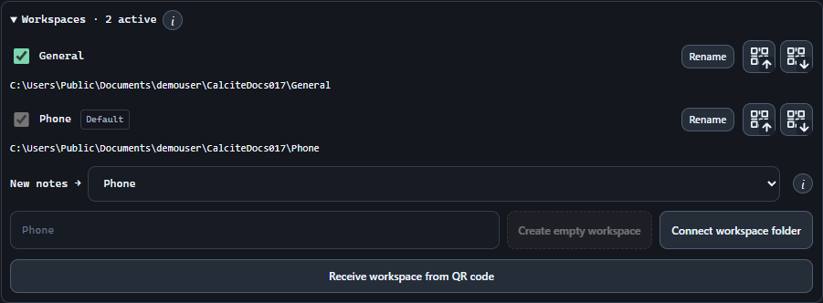
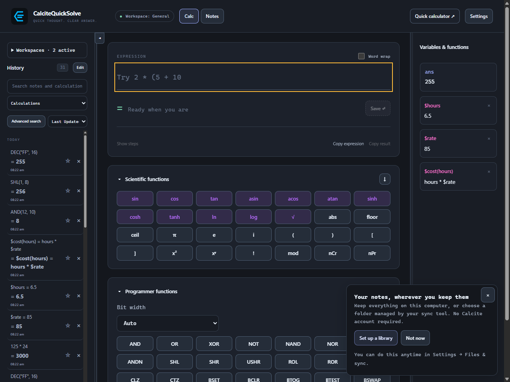
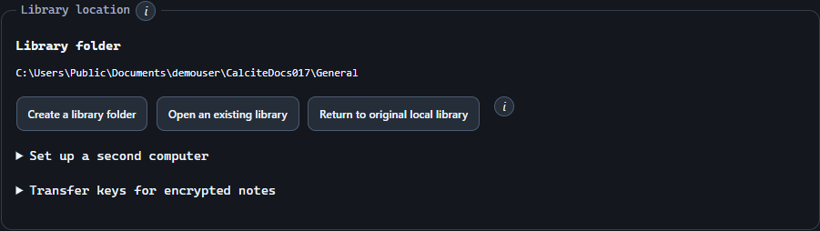
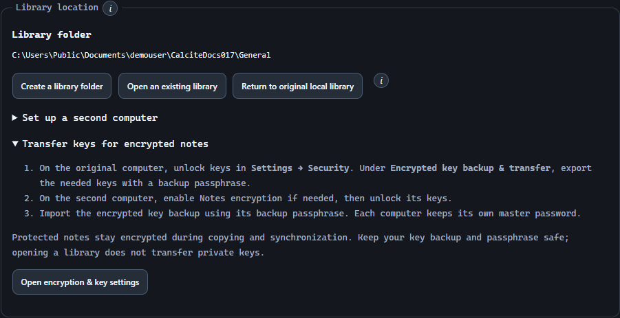

# Choose a library. Bring your own sync.

Create or connect workspace folders and unlock their password-encrypted keys on each device. Works offline; Syncthing, Google Drive or OneDrive can provide file transport for shared folders.

## Immutable history and conflict review

Use 1.0.0 or later on every editing device. CQS publishes immutable, hash-verified note states and parent links under notes/<note-id>/history. It uses Git-style history without creating a .git repository, shared index or HEAD. Each installation keeps its accepted copies, recovery journals and keys locally.

- Saved revisions and attachment dependencies travel through the shared folder. A passive Syncthing relay needs no running CQS instance, and editing devices can work offline.
- Incoming objects are checked before activation. Missing parents, partial transfers, invalid bytes and locked encrypted records stay pending; repeated scans do not create duplicate history.
- Compatible changes merge automatically by default. Different merge orders across several devices can be reconciled by combining their verified common versions; genuinely overlapping text, protection changes and deletion/edit disagreements require the configured conflict decision.
- Keep Syncthing conflict copies enabled. maxConflicts = 0 can discard an unobserved raw-file collision. The normal positive limit is suitable; -1 retains unlimited conflict copies while testing.

## Choose workspace folders

Open Settings → Files & sync → Workspaces. Each workspace has its own folder, and each note belongs to one workspace.

- Create empty workspace starts a new collection; Connect workspace folder opens an existing synchronized folder. Receive workspace from QR code adds or merges a QR workspace. A receive icon beside an existing workspace only accepts its matching ID.
- The left sidebar stays open while you tick or untick workspaces. Its three-dot Actions button opens a nearby popup with Details, QR Export <name> and QR Import <name>.
- Files & sync lists Rename, the document-lines Details icon, QR Export, QR Import and a red X for deletion on one row. On mobile, the first actions stay left aligned and the red X stays at the far right above the workspace encryption controls. The desktop header no longer repeats the original workspace name.

1. Enter a name and choose Create empty workspace. Select a parent directory; Calcite creates a separate Calcite-Workspace-<name>-<UUID> folder without copying your existing notes.
2. To connect a folder received from another device, choose Connect workspace folder and select its root containing cqs-library.json.
3. Check the workspaces you want active in Settings or the history sidebar. History, search, and Trash combine their notes.
4. Choose New notes → to set this device’s default save destination. New notes, Quick Notes, and imports use it; existing notes and drafts keep their workspace.
5. Use Rename beside a workspace to change its display name on this device. Its folder and note ownership stay the same.

> Deactivating a workspace hides it from the combined view. It stays connected, receives file updates, and is included in backups. Choose another default before deactivating the current one. Activation does not change your sync tool’s folder shares.

[QR transfers: sending, receiving and troubleshooting](qr-transfers.md)
[Workspace, vault and note keys explained](keys-and-encryption.md)

## Remove a workspace or move its notes to Trash

In Settings → Files & sync, choose the red X at the right of the workspace’s action row. Select an action, wait three seconds for Confirm, then confirm. Changing the action restarts the delay.

- The original workspace stores calculator state and cannot be disconnected or permanently removed. Its notes can still move to Trash.
- If the removed workspace was the default, Calcite chooses a remaining active workspace. At least one workspace remains active.
- Trashing notes or deleting workspace files in a synced folder can propagate those deletions to other devices. Keep files only changes this device’s connection.

| Action | Result |
| --- | --- |
| Keep files | Disconnect this workspace on this device. Notes, attachments, history and the folder remain unchanged. Reconnect later or remove the files manually in the OS. |
| Keep files & move notes to Trash | Move current and archived notes into Calcite’s Trash. Keep the workspace connected so notes can be restored. Existing Trash retention applies. |
| Remove from storage & permanently delete | Permanently remove workspace notes, attachments, history, metadata and local cached copies, then disconnect. Other files in the folder remain. This cannot be undone. |

## Start locally, or choose a folder

The nonblocking first-start suggestion offers Set up a library and Not now. It does not take focus from the calculator, require an account, or start the Notes trial.

1. Continue using the original local library if it suits you. Choose Not now to dismiss the suggestion on this computer.
2. To set up a different location, choose Set up a library, or open Settings → Files & sync → Library location.
3. Start the 30-day Notes trial or import an activation in Settings → License when you want to use Notes. The calculator remains free.

> CQS operates fully offline. An external client handles any file transfer, sign-in, storage quota, and organizational sharing permissions. No Calcite account or hosted sync service is required.

## Move the primary library to a folder

Library location → Create a library folder copies the primary workspace’s saved notes, attachments, history, and Trash into a new folder. Additional connected workspaces are not included. Use Workspaces above to connect several folders at once.

1. Save your notes and finish reviewing any incoming changes you want included. Choose a parent folder that your sync tool is configured to synchronize, or a normal local folder for offline use.
2. In Library location, choose Create a library folder and select that parent directory. CQS creates a uniquely named Calcite-Library-<UUID> child folder inside it.
3. Review the selected path. The new library includes saved notes, attachments, version history, and Trash, preserving note IDs and encrypted bytes.
4. Choose Use library and restart. CQS saves writable drafts in all loaded Notes windows before switching. A failed or conflicting save stops the change so you can resolve it.
5. After restart, return to Library location and confirm the active folder. Check your notes before proceeding with another computer.

> The destination is a new library folder; existing libraries are not overwritten. Failed copies never become the active library. Other recovery drafts remain in this computer’s library-specific recovery journals.

## Open a primary library on another computer

The folder’s cqs-library.json manifest identifies its library and workspace. There is no need to copy workspace settings or manually match workspace names.

1. On the first computer, configure Syncthing, Google Drive, or OneDrive to synchronize the entire newly created library folder. It must include cqs-library.json and the complete notes tree.
2. Wait for the initial transfer to finish. Make the full contents available offline on the second computer; online-only placeholders are insufficient. Confirm that the provider actually synchronizes this folder between those computers—a backup-only configuration is not bidirectional sync.
3. Install the current CQS version on the second computer. Save any existing work, then open Settings → Files & sync → Library location → Open an existing library.
4. Select the library root containing cqs-library.json. Review the recognized library name, location, total note count, and encrypted-note count.
5. Choose Use library and restart. This opens the selected library; it does not merge its notes with the previous local library.
6. Verify an ordinary note and an attachment. For encrypted notes, complete the key-transfer steps below before expecting them to open.

## Unlock protected workspaces on another device

Protect workspace in Files & sync creates a separate password-protected key bundle that travels with that workspace. Set up and unlock a local vault on the receiving device, connect the shared folder, then choose Unlock workspace and enter the workspace password once. Thereafter, the receiving device’s local master password or Android device unlock opens its cached workspace key.

- Transfer the complete folder, including cqs-workspace-vault.json. CQS keeps a local protection record; deleting or replacing the shared bundle cannot silently turn later writes into plaintext.
- For mixed plain/encrypted workspaces, create a workspace key in Settings → Security without choosing Protect workspace. Share its key in the initial password-encrypted QR import of a new workspace, or use Encrypted key backup & transfer for matching keys on an existing device. This does not enable whole-workspace storage encryption. The same local master password alone does not recreate keys.
- Workspace and local-vault passwords can differ. Changing a workspace password only changes that workspace’s portable wrapper; changing a local master password only changes local unlock.

[PC, phone, passwords and biometrics](security-and-backups.md)

## What travels and what stays on each device

Share cqs-library.json, the complete notes/ tree, and cqs-workspace-vault.json when the workspace is protected. The latter contains only that workspace’s password-encrypted key. Local vault files, settings, activation, recovery credentials, device unlock enrollment, MCP grants and search indexes stay on each device.

| Travels with the library | Stays local to each computer |
| --- | --- |
| Notes, downloadable attachments, versions, and Trash/deletion records | Application settings, workspace connections, active selections, default save destination, and window layout |
| Tags, assigned labels, note-to-note links, and protection information | Calculator history, variables, functions, and graphs |
| Library and workspace identity in cqs-library.json | License activation, saved searches, and unused label definitions |
| Encrypted note content, still encrypted | Local vault files stay private. A protected workspace includes only its own password-encrypted key bundle. |
| Complete note files and their managed attachments | MCP grants, agent credentials, export destinations, and search caches |

> A note link to a saved calculation on the first computer cannot resolve that calculation on the second unless its calculator history is separately imported. Renaming a workspace is a local display preference; it does not rename the library manifest.

## Receive complete updates while CQS is open

Enable Watch external files in Settings → Files & sync. CQS checks connected workspace folders while running and scans on startup. Use the refresh icon beside History for an immediate scan after a sync.

- Complete non-conflicting updates and compatible merges apply automatically by default. Turn on Review every incoming note change to accept each incoming note explicitly, including after restart. Automatic concurrent merging can also be disabled separately.
- An open note incorporates compatible updates while preserving typing and its cursor or selection where possible. Overlapping unsaved edits are retained and produce a notification.
- When CQS was closed during a sync, startup compares incoming immutable history against the local accepted copy. Replacing note.json with an older version cannot by itself erase an acknowledged saved revision.

## Review conflicts and deletions

By default, CQS asks when you open a note whose changes cannot be determined automatically. The banner says X notes have conflicts and need review; its information button explains recovery. A ! beside a note’s star opens its review directly.

- Files & sync offers Ask when opening the note, Use theirs and notify me, and Use mine and notify me. Review every incoming note change takes priority over automatic choices.
- Basic review offers Keep my version, Use received version, Keep both as notes and Combine changes when the merge is clean. Advanced adds Base, editable result text and field choices. Originals remain in history.
- My version and Received version have borders. Long comparisons show disputed excerpts with line numbers and a full-version toggle. Editing or saving the combined result keeps the complete note.
- Resolve once on any unlocked installation. The resolution retains both inputs and travels to the other devices, clearing that conflict even if those devices were closed or had not reviewed it. Review-every-change users still review received resolutions.
- Recognized Syncthing conflict files and validated renamed note copies are captured into history, archived locally and removed from the shared folder. No separate Syncthing conflict-resolution step is needed. Provider permission, disk-space, login or connectivity errors still belong to the provider.
- Changing note encryption while another device edits the old state creates a protection/content conflict. An authorized, unlocked device can keep the edit with the chosen protection; a locked device waits for its keys and then receives the same resolution.

## Switch libraries or return to the original

Library location lets you reopen a previous library or choose Return to original local library.

1. Save your current work and select the destination library, or choose Return to original local library.
2. Review the location and choose Use library and restart. Resolve any draft-save failure before trying again.
3. Confirm the active location after restart. Reopening a selected library returns to its own saved local profile on this computer.

> Returning to the original does not copy changes back from the selected folder. Switching connects to another library; it is not a merge or a backup restore.

## When a library folder is unavailable

If a selected folder disappears, has an incomplete manifest, or contains a different workspace identity, CQS blocks writes to that location and preserves accepted local notes. Let the sync finish, restore access, or reconnect the intended workspace in Files & sync.

- Reinitialise workspace is an explicit recovery option in the warning and workspace settings. Review its warning and confirmation delay. It backs up local recovery data and restores the expected workspace from accepted copies without replacing unrelated received notes.
- Reinitialisation can lose changes that never reached the accepted local copy. Keep an independent backup and restore normal access first when possible.
- Remove connection keeps the folder and keys. Delete workspace offers its own confirmed keep-files or remove-files choices. A missing manifest no longer prevents removing a stale connection.
- A retained private QR workspace can be reimported by identity and reviewed before merging. Ordinary private-folder removal works on Android; directory links are still rejected.

## Use an organization’s folder policy

Have the organization choose approved locations, file access, device setup, and a handoff process. Sharing a directory shares the files; it does not create CQS roles or single sign-on.

- Include Syncthing, Google Drive, or OneDrive only when the organization approves and configures that tool for the specific library folder.
- Keep license activation, MCP grants, private keys, and recovery material device-local. Grant agent access separately on each device.
- Transfer encrypted key backups explicitly for authorized recipients; a UI lock does not revoke an existing MCP grant.
- Keep independent, dated backups outside the active synchronized library. Sync can propagate deletions and mistakes.

## Library sync, live exports, and backups

A selected library contains note records that CQS can open on another computer. Live Markdown/text exports are separate, one-way copies of saved notes; editing those exported files does not edit the source library.

- Configure each device’s live-export destinations separately. They are not transferred with the note.
- All — full library backup and Notes, images & keys include accepted notes from every connected workspace, including inactive ones, with local state and encrypted key files. Save drafts and review pending incoming changes first.
- Keep backups outside a selectively shared workspace: a full backup can include General even when only Phone is shared.
- Follow RESTORE.txt with Calcite closed. Restore the primary profile and unlock its restored keys, then copy each additional workspaces/<workspace-id> folder to an empty location and connect it. Do not overwrite a live synced folder.

[Configure one-way live exports](note-exports.md)
[Create and restore a full backup](security-and-backups.md)

## Sync complete attachments

Sync the entire notes tree, including attachment manifests, data chunks and any XOR recovery chunks.

[Syncthing setup example](syncthing.md)

## Resolve missing or deleted workspace folders

Deleting a workspace folder outside Calcite does not remove its saved connection. A missing or inaccessible workspace is shown separately from ordinary file conflicts; cached notes and encryption keys are preserved.

- In Review files, choose Workspace settings to restore or reconnect the folder, Remove connection to forget it on this device while keeping cached data, or Dismiss warning to hide that warning. Removing the connection has a three-second confirmation delay and chooses a remaining active default save workspace when needed.
- A dismissed warning stays hidden across restarts until its error changes, or the folder recovers and later becomes unavailable again. Other workspaces and real file conflicts continue to appear normally. Missing-folder details and Remove connection are also available in Files & sync when monitoring is off.
- In Files & sync, Keep files removes a stale connection without requiring the original folder. Permanent deletion also removes the workspace-owned cached data when the original directory is confirmed missing. If the folder exists, Calcite validates its identity before deleting workspace files; unrelated files remain.
- Permission failures, provider outages and replacement folders are not treated as confirmed deletion. If Calcite cannot safely verify storage, permanent deletion stops; Keep files or Remove connection can still disconnect it.
- For an unavailable folder, Delete cached copies only & disconnect is an explicit alternative. It permanently removes this device’s workspace cache without needing the old folder’s permission or provider. The original folder and files on other devices remain untouched; encryption keys are kept.
- Move notes to Trash requires a writable workspace folder. It is disabled for an unavailable workspace with an explanation. Restore or reconnect its folder first to use that action. It keeps the workspace connected so notes can be restored.
- The original workspace stores calculator state and cannot be disconnected. Restore its storage or resolve the reported problem in settings.
