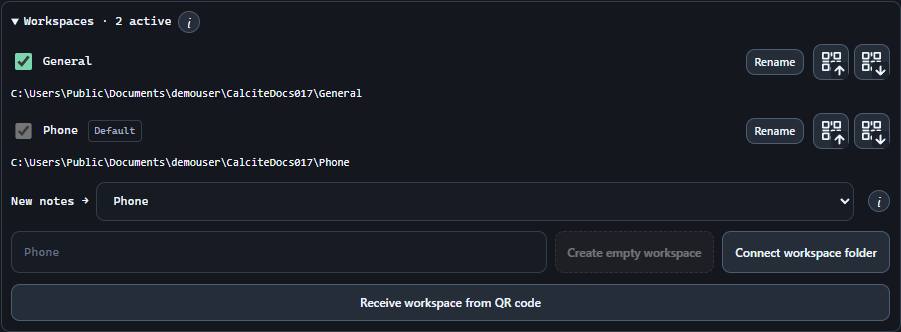
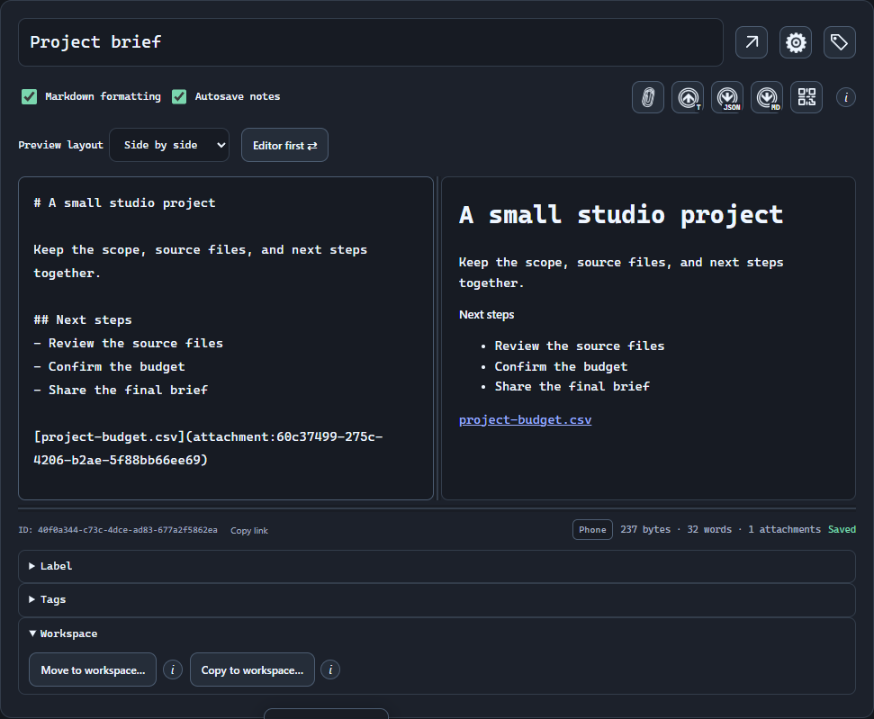

# Share a library with Syncthing.

Share selected workspace folders between devices while keeping other workspaces local.

## Immutable history and conflict review

Use 1.0.0 or later on every editing device. CQS publishes immutable, hash-verified note states and parent links under notes/<note-id>/history. It uses Git-style history without creating a .git repository, shared index or HEAD. Each installation keeps its accepted copies, recovery journals and keys locally.

- Saved revisions and attachment dependencies travel through the shared folder. A passive Syncthing relay needs no running CQS instance, and editing devices can work offline.
- Incoming objects are checked before activation. Missing parents, partial transfers, invalid bytes and locked encrypted records stay pending; repeated scans do not create duplicate history.
- Compatible changes merge automatically by default. Different merge orders across several devices can be reconciled by combining their verified common versions; genuinely overlapping text, protection changes and deletion/edit disagreements require the configured conflict decision.
- Keep Syncthing conflict copies enabled. maxConflicts = 0 can discard an unobserved raw-file collision. The normal positive limit is suitable; -1 retains unlimited conflict copies while testing.

## Share Phone without sharing General

Install Syncthing and pair the devices using Add Remote Device and their device IDs.

1. On the desktop, open Settings → Files & sync → Workspaces. Enter Phone, choose Create empty workspace, and select a parent outside General’s folder.
2. In Syncthing, share only the generated Calcite-Workspace-<name>-<UUID> folder. Include cqs-library.json and the complete notes tree. Keep General and the parent directory outside the share. Use Send & Receive on both devices for edits in both directions.
3. Accept the share on the receiving device using an empty local folder and the same Syncthing folder ID. Wait for the initial transfer to finish, then choose Connect workspace folder in Calcite and select the received root. Do not create another Phone workspace there.
4. Keep General and Phone active on the desktop. On the other device, choose Phone as the New notes default before deactivating General. Each device has its own active selection and default.
5. Enable Watch external files and Automatically apply non-conflicting note updates on both devices. Protected workspaces carry encrypted keys: unlock the local vault, then enter the workspace password in Files & sync. Older selective-note keys can still use encrypted key-backup transfer.

> Sync the entire notes tree, including attachment manifests, data chunks and any XOR recovery chunks.

## Put notes in the shared workspace

With two or more workspaces active, show Note metadata and expand Workspace below Tags.

- Move to workspace… transfers the note and its attachments to Phone, retaining the note ID and history. Devices sharing General receive its removal after the move syncs.
- Copy to workspace… leaves an independent note in each workspace. Later edits do not copy between them.
- Both actions save current edits first. Encryption is preserved; signatures must be applied again.
- Devices sharing only Phone do not receive General’s other notes. Wait for both folders to finish syncing before editing a moved note elsewhere.

## Try a round trip

Create a test note on A, wait for Saved and for Syncthing to finish, then open and edit it on B. Verify the change returns to A. Repeat with an attachment and an encrypted note if used.

## Conflicts and backups

Syncthing transports files and normally keeps syncing after a file conflict, naming the alternate file as a conflict copy. CQS handles the note-level review and history. Keep independent backups outside the synchronized folder because Syncthing also transfers deletions.

- Leave conflict copies enabled; do not set maxConflicts to 0 as a way to resolve CQS conflicts. Unlimited copies (-1) are useful during testing if you monitor disk use.
- CQS checks files and ancestry rather than calling the Syncthing API. Valid note.sync-conflict-*.json and recognized renamed siblings are preserved in history before the transport copies are archived locally and removed.
- Clean merges happen automatically by default. For a real overlap, choose a resolution in CQS once; the resulting note and history propagate to the other installations without another provider-side resolution.
- If a device was closed when a provider overwrote its files, the next startup still checks its private accepted history. A sync app cannot supply changes whose only remaining copy was deleted before CQS observed it.
- Google Drive and OneDrive can carry the same complete workspace format. Keep its files available offline. Actual cloud clients, authentication and placeholder behavior must be verified for your setup.

[Library sync and conflict handling](sync.md)
[Security and backups](security-and-backups.md)
